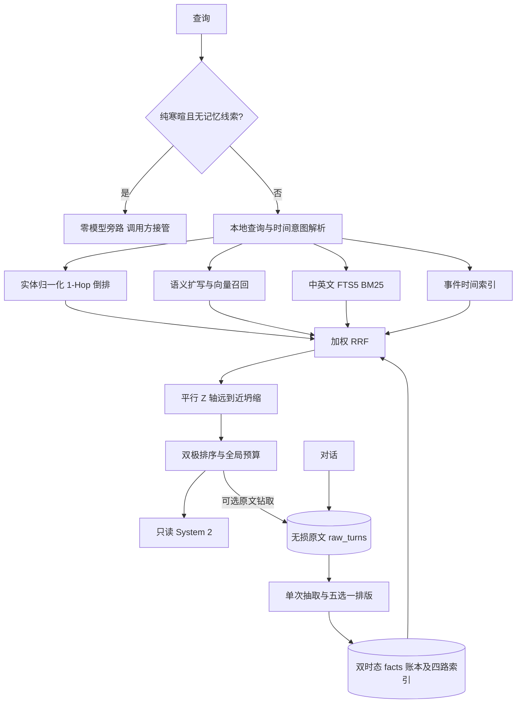

# 认知记忆引擎

用无损原文和双时态事实账本维护 2D 笔记与修订。向量、FTS5 BM25、实体倒排和时间索引通过四路 RRF 召回候选。平行实体 Z 轴隔离上下文，双极渐近环保留高频核心与单次例外，并按分数软裁剪夹层。System 2 仅作答。

## 架构



- **双极渐近环：** 径向坐标由来源轮次和历史命中数决定。默认两极权重为 `1.0`，正中间为 `0.10`。夹层条目低于最高分的 `35%` 时可软裁剪，随后应用槽位和 Token 预算。
- **排版与修订：** 同行覆写留历史、紧挨换行成簇、孤立隔行标注例外；另支持软删除和 `NOOP`。Live 由 `notebook_layout.txt` 一次抽取并决策。
- **双轨与隔离：** RRF 相关性乘以双极系数（`bipolar_lambda=0.50`），由远及近坍缩 Z 桶后按总分统一截断；`ranked` 保留排序，三区统计可单独读取。
- **只读推理：** `answer()` 可复用 `retrieve()`；单独调用 `answer()` 时，内部检索也不变更原点或刷盘。模型输出中的写入指令和边界字段不被采纳。

完整公式、边界条件和存储契约见 [设计说明](docs/DESIGN.md)。原始提案和历史目标见 [规格](docs/SPEC.md)。

## 安装与接口

```bash
pip install -e ".[dev]"
```

需要 Python 3.10+、NumPy；单测使用 pytest。

```python
from memengine import CognitiveMemoryEngine

engine = CognitiveMemoryEngine(db_path="memory.db", categories=["基础设施"])
scope = {"user_id": "alice", "agent_id": "assistant"}
written = engine.add("老周对苯甲酸钠过敏。", **scope, session_id="chat-1", role="user")
query = "老周对哪种防腐剂过敏？"
evidence = engine.retrieve(query, **scope, top_k=10, token_budget=2048)
print(engine.answer(query, **scope, retrieved=evidence)["response"])
engine.delete(written["operations"][0]["line_id"], **scope)  # 软删除，保留审计记录
```

- `search()` 兼容 `retrieve()`。可按 `session_id` 过滤；默认跨当前用户/Agent 的会话检索。
- `add(..., event_time=...)` 可单独记录事件发生时间。`sync=False` 仍先保存原文，事实抽取和索引进入进程内队列。非只读任务检索默认先刷本租户队列，可设 `flush_pending=False`。只读查询使用 `read_only=True`。
- `retrieve(..., include_raw_turns=True)` 返回前三条事实的原文及同会话相邻轮，字段为 `drilldown_turns`。
- `timestamp` 仅对当前调用生效。固定时钟用 `set_time()`；恢复用 `reset_clock()`。
- `delete(..., hard=True)` 删除事实版本链及实体、全文和向量索引。独立原文日志、备份和外部服务留存需要分别处理。

## 模型配置

默认 LLM 是确定性 `MockLLMClient`。要启用 Live，可以把 `OpenAICompatibleClient()` 传给 `llm=`，或使用 `build_llm_from_env()` 选择客户端。

| 环境变量 | 含义 |
| --- | --- |
| `LLM_BASE_URL` | Chat 接口根路径，默认 `https://api.openai.com/v1`。 |
| `LLM_API_KEY` / `OPENAI_API_KEY` | Chat 接口密钥。 |
| `LLM_MODEL` | Chat 模型名，默认 `Qwen2.5-7B-Instruct`。 |
| `EMBEDDING_BASE_URL` / `EMBEDDING_MODEL` | 同时设置时启用 OpenAI 兼容 `/embeddings`。 |
| `EMBEDDING_API_KEY` | 若向量服务需要鉴权，设置此密钥。 |

未配置远程服务时，向量通道使用本地 `HashedTfidfEmbedder`。远程编码在写入时失败，则保存本地向量。查询只计算能成功编码且模型和维度相符的向量。指定 `vector=` 可替换向量后端。FTS5、实体和时间索引始终可用。

## 测试与评测

```bash
python3 -m pytest -v
python3 -m eval.run_eval --scale small
python3 -m eval.membench.run --sample 5 --mode mock
python3 -m eval.bipolar_ablation stress --out /tmp/bipolar-stress.json
python3 -m eval.bipolar_ablation membench --data-dir /path/to/MemData --out /tmp/bipolar-membench.json
```

阶段 A 跨版本比较可在 MemBench 命令加 `--phase-a --reference /path/to/previous-membench.json`。它先核对题目与证据集，再报告四路模式相对于此前双路 RRF 的变化。

合成评测比较朴素 RAG、自写 CRUD、关闭时间轴缓冲与闲聊旁路的消融版本，以及完整链路。准确率按关键词和禁用词计，陷阱幻觉率单独统计；检索 P95 不含 System 2 作答。`--mode auto` 有 Chat 密钥时走 Live，否则走 mock。规格中的目标，以及 `eval/results/small_eval.*` 中重构前的归档结果，都不是这版运行的成绩。

MemBench 使用官方 `import-myself/Membench` 仓库的 `MemData` 分类文件，不是论文里的 `data2test` 加噪集。`--sample` 是每个大类的数量；首次运行需要下载，离线机器可用 `--data-dir` 指向预置数据。检索和 System 2 只看题干，选择题适配器将自然语言答案映射为选项。另外比较同一作答头下的检索证据、无记忆、全上下文，并报告证据 step 的 Recall@10。Mock 评测验证流程，不代表语言模型准确率；旧 `sample20_mock.*` 为历史归档。

### 零 API 证据评测

```bash
python3 -m eval.locomo.run --sample 100 --seed 42 --data-dir /path/to/locomo10.json --out /tmp/locomo.json
python3 -m eval.longmemeval.run --sample 100 --seed 42 --data-dir /path/to/longmemeval_s_cleaned.json --out /tmp/longmemeval.json
```

`--sample` 是总题数，按题型轮流分层抽样。省略 `--data-dir` 时使用各模块的 `.cache/`，缺文件才下载；评测不调用生成、Embedding 或裁判 API。两组共享同一只读检索调用的 RRF 池、Top-10 与 2048 Token 预算。前 K 条事实覆盖的官方轮次或会话 ID 用于 Recall@K；MRR 按首条命中事实的排名计算。无金标或拒答题不计 Recall/MRR；标注存在但无法映射的 ID 仍留在分母。Token 为引擎估算值，不是供应商计费 Token。

- LoCoMo 依发布文件与 [官方评测代码](https://github.com/snap-research/locomo/blob/main/task_eval/evaluation.py) 标注：1 多跳、2 时间、3 开放域、4 单跳、5 对抗。对抗题的「噪声泄漏」指存在不与标注证据轮次相交的检索事实；冗余 Token 只计算这些事实。它不是生成式拒答准确率，也不把陷阱答案当金标。
- LongMemEval-S 另报会话级证据。`has_answer` 和 `answer_session_ids` 只在打分时使用；写入用不含答案标记的会话标识。`_abs` 单独分桶。更新支配率只评估可识别的官方旧/新版本对：新事实严格排在旧事实前，或选中新事实且查到同一行的旧修订归档。两者都没检出、只检出新版但无法证实归档，均不算支配。
- 默认软裁剪不是强制压缩。保留预设阈值先复跑压力集；压缩或 MRR 未领先时命令报告未达标，不改对照组或事后替换样本。
