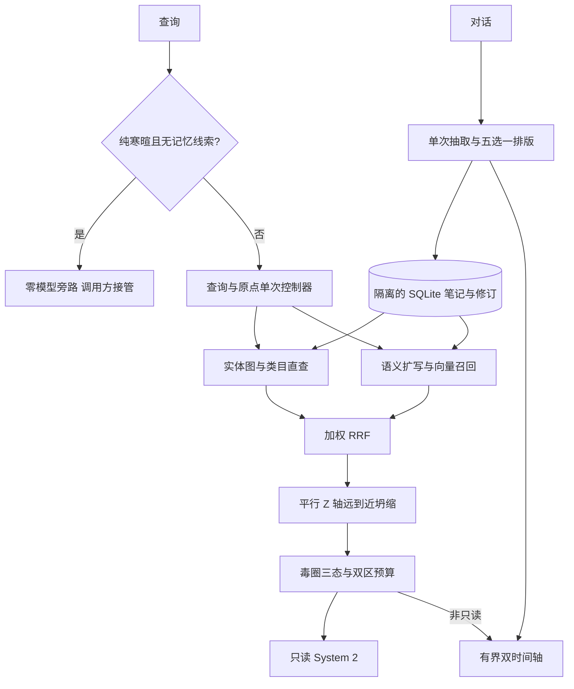

# 认知记忆引擎

用 2D 笔记维护事实和修订，用平行实体 Z 轴隔离上下文。向量召回只是一路候选：渐近原点提供径向引力，毒圈丢弃无关噪声，并为有锚点的罕见例外保留独立配额。System 2 只作答，不写记忆，也不改边界。

## 架构



- **渐近与毒圈：** `d_asymp = max(0.05, d_origin)`，`P_radial = 0.05 / d_asymp`。语义距离和结构惊奇度独立，圈外低惊奇度或无锚点的事实不进入证据。
- **排版与修订：** 同行覆写留历史、紧挨换行成簇、孤立隔行标注例外；另支持软删除和 `NOOP`。Live 由 `notebook_layout.txt` 一次抽取并决策。
- **双轨与隔离：** 加权 RRF 后先隔离 Z 桶，再使用 `query_origin_controller.txt` 提供的权重排序，按 `top_k` 与估算的 `token_budget` 保留两区证据。
- **只读推理：** `answer()` 可复用 `retrieve()`；单独调用 `answer()` 时，内部检索也不变更原点或刷盘。模型输出中的写入指令和边界字段不被采纳。

完整公式、边界条件和存储契约见 [设计说明](docs/DESIGN.md)。原始提案和历史目标见 [规格](docs/SPEC.md)。

## 安装与接口

```bash
pip install -e ".[dev]"
```

需要 Python 3.10+、NumPy；单测使用 pytest。

```python
from memengine import CognitiveMemoryEngine

engine = CognitiveMemoryEngine(db_path="memory.db", categories=["基础设施"])
scope = {"user_id": "alice", "agent_id": "assistant"}
written = engine.add("老周对苯甲酸钠过敏。", **scope, session_id="chat-1", role="user")
query = "老周对哪种防腐剂过敏？"
evidence = engine.retrieve(query, **scope, top_k=10, token_budget=2048)
print(engine.answer(query, **scope, retrieved=evidence)["response"])
engine.delete(written["operations"][0]["line_id"], **scope)  # 软删除，保留审计记录
```

- `search()` 兼容 `retrieve()`。可按 `session_id` 过滤；默认跨当前用户/Agent 的会话检索。
- `add(..., event_time=...)` 可单独记录事件发生时间。`sync=False` 进入进程内队列；非只读任务检索默认先刷本租户队列，可设 `flush_pending=False`。不希望更新控制状态时传 `read_only=True`。
- `timestamp` 仅对当前调用生效。固定时钟用 `set_time()`；恢复用 `reset_clock()`。
- `delete(..., hard=True)` 删除笔记行、Z 键和修订，不擦除独立的原始 ingest、备份或外部服务留存。

## 模型配置

默认 LLM 是确定性 `MockLLMClient`。要启用 Live，可以把 `OpenAICompatibleClient()` 传给 `llm=`，或使用 `build_llm_from_env()` 选择客户端。

| 环境变量 | 含义 |
| --- | --- |
| `LLM_BASE_URL` | Chat 接口根路径，默认 `https://api.openai.com/v1`。 |
| `LLM_API_KEY` / `OPENAI_API_KEY` | Chat 接口密钥。 |
| `LLM_MODEL` | Chat 模型名，默认 `Qwen2.5-7B-Instruct`。 |
| `EMBEDDING_BASE_URL` / `EMBEDDING_MODEL` | 同时设置时启用 OpenAI 兼容 `/embeddings`。 |
| `EMBEDDING_API_KEY` | 若向量服务需要鉴权，设置此密钥。 |

远程向量失败或未配置时，回退到本地 BM25 与哈希 TF-IDF/词元混合相似度。指定 `vector=` 可完全替换向量后端；使用远程模型时，请先确认允许发送相应的记忆文本。

## 测试与评测

```bash
python3 -m pytest -v
python3 -m eval.run_eval --scale small
python3 -m eval.membench.run --sample 5 --mode mock
```

合成评测比较朴素 RAG、自写 CRUD、关闭时间轴缓冲与闲聊旁路的消融版本，以及完整链路。准确率按关键词和禁用词计，陷阱幻觉率单独统计；检索 P95 不含 System 2 作答。`--mode auto` 有 Chat 密钥时走 Live，否则走 mock。规格中的目标，以及 `eval/results/small_eval.*` 中重构前的归档结果，都不是这版运行的成绩。

MemBench 使用官方 `import-myself/Membench` 仓库的 `MemData` 分类文件，不是论文里的 `data2test` 加噪集。`--sample` 是每个大类的数量；首次运行需要下载，离线机器可用 `--data-dir` 指向预置数据。检索和 System 2 只看题干，选择题适配器将自然语言答案映射为选项。另外比较同一作答头下的检索证据、无记忆、全上下文，并报告证据 step 的 Recall@10。Mock 评测验证流程，不代表语言模型准确率；旧 `sample20_mock.*` 为历史归档。
