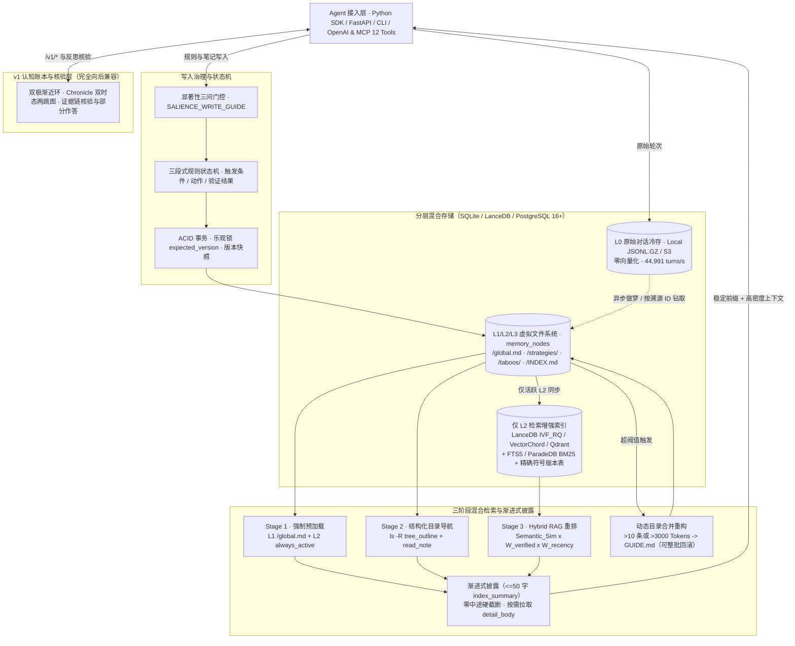

# Agent Memory Engine（认知与虚拟文件系统记忆引擎）

面向强模型 Agent 的高性能双代混合记忆引擎，融合 **v2 虚拟文件系统记忆引擎（`VFSMemoryEngine`）** 与 **v1 双极双时态认知账本（`CognitiveMemoryEngine`）**：

- **混合分层存储**：以关系数据库（SQLite WAL / PostgreSQL 16+）承载虚拟文件系统与状态机，L0 原始对话解耦至分块冷存储（本地 `.jsonl.gz` / S3 / OSS）且**绝不向量化**，仅对精炼 L2 Markdown 规则建立向量、BM25 与精确标识符索引（支持 LanceDB `IVF_RQ`、VectorChord `vchordrq`、DiskANN、ParadeDB `pg_search` 与 Qdrant）。
- **三阶段混合检索**：强制预加载（L1 `/global.md` + L2 `always_active`）→ 结构化目录导航（`ls -R` 大纲 + `read_note` 主动翻阅）→ 混合语义 + 元数据过滤 + 公式重排，结合精确符号/版本分级零串台门禁。
- **高密度读写输出**：写入端三问显著性门控与 `[触发条件] + [动作] + [验证结果]` 假设/规则状态机；读取端以 `<=50` 字 `index_summary` 渐进式披露替代粗暴字符硬截断，目录超阈值自动合并重构为 `GUIDE.md` 且支持整批原子回滚。

---

## 系统架构图



---

## 核心原理概述

### 1. 分层混合存储与防发热设计（L0 / L1 / L2 / L3）
- **为什么用关系库模拟虚拟文件系统**：强 LLM 对“目录树 + Markdown 文本”有天然读写亲和力，但纯文件难以处理多 Agent 并发写冲突与错误回滚。核心表 `memory_nodes`（`node_id`、`parent_path`、`path`、`title`、`summary`、`content`、`layer`、`confidence_score`、`verification_status`、`salience_tag`、`always_active`、`content_tokens`、`source_transcript_ids`、`version`）在保留目录树体验的同时，提供 **ACID 事务、行级乐观锁（冲突返回 `OptimisticLockError` / HTTP 409）、版本快照、整批回滚（`rollback_batch`）与严格租户隔离**。
- **L0 解耦冷存与仅 L2 向量化**：原始对话按 `user/agent/session/date` 分块压缩落盘（`.jsonl.gz` 或 S3/OSS），**永不进入向量索引**，彻底杜绝海量过时对话噪声淹没规则或引发大库检索 CPU 发烫。
- **多后端能力分级自动适配**：
  - **SQLite WAL（默认，≤500 条 L2 最轻量）**：零依赖、毫秒级检索与 CI 极速运行。
  - **SQLite + LanceDB（`lancedb:///path`，本地 2K–50K 推荐）**：SQLite 负责 ACID 元数据与精确表，Rust + Apache Arrow/Lance 接管磁盘零拷贝向量与 **RaBitQ (`IVF_RQ`)** 量化 ANN，免外部服务即可压降 70% CPU。
  - **PostgreSQL 16+（`postgresql://`，多 Agent 分布式并发）**：启动自动探测升级——向量层 `vchordrq` (VectorChord) → `diskann` (pgvectorscale) → `hnsw` (pgvector) → `sql-array`；词法层 `pg_search` (ParadeDB BM25) → `vchord_bm25` → `tsvector`；亦支持外挂 `QdrantL2Index`。

### 2. 三阶段混合检索管线与精确符号门禁
传统“Query → Top-K 向量相似度”容易漏掉字面不相似但逻辑强相关的规则，也常在版本号/错误码上串台。本引擎采用三阶段管线：
1. **Stage 1 强制预加载**：无论查询主题是什么，无条件加载 L1 `/global.md` 与 L2 中 `always_active=True` 的高频避坑规则。
2. **Stage 2 结构化目录导航（Agentic Tree Search）**：通过 `tree_outline()` 向 Agent 暴露类似 `ls -R` 的轻量目录大纲（仅路径 + ≤50 字 `index_summary` + 状态标签），支持模型主动调用 `read_note(path)` 按需翻阅完整笔记。
3. **Stage 3 混合语义 + 元数据过滤 + 公式重排**：融合 Dense 向量 + BM25/FTS5 + L2 精确标识符表（`memory_node_identifiers`，写入建表、查询 $O(1)$ 命中）与 8 类版本精度分级（精确/包含/粗粒度/兄弟/预发布/区间/跨产品），按以下公式重排：

$$\text{Final Score} = \text{Semantic\_Sim} \times W_{\text{verified}} \times W_{\text{recency}}$$

- **已验证规则压倒未验证假设**：`verified` 权重 `1.35`，`unverified` 权重 `0.55`，避免将单次猜测当作真理。
- **时效与常驻分离**：`always_active` / `taboo` / `core_rule` 的 $W_{\text{recency}} \equiv 1.0$ 永不衰减；普通笔记按 `updated_at` 平滑衰减于 `[0.82, 1.00]`，既确保新更新稳定压过旧事实，又不让近期弱噪声掩盖数月前的高相关记忆。
- **严格缺失空返**：针对版本号、错误码、代码符号、文件路径执行精确核验，不存在时返回空集，杜绝版本串台。

### 3. 写入显著性门控、渐进式披露与动态合并
- **写入端三问引导与状态机**：提供轻量自检提示 `SALIENCE_WRITE_GUIDE`（不死板限制“只记失败”）：① 当前上下文能否直接看到？② 是一次性状态还是可复用规律？③ 未来新会话没有它会不会踩坑？`write_rule()` 强制采用 `[触发条件] + [动作] + [验证结果]` 结构，缺少有效验证结果时自动降级为 `unverified` 且 `confidence_score <= 0.65`。
- **读取端渐进式披露替代硬截断**：每条 L2 节点维护 `index_summary`（≤50 字一句话结论）与无损 `detail_body`。`build_context(disclosure="progressive")` 与 `mem_search` 默认仅返回摘要卡片，由模型按需 `read_note(path)` 拉取全文；即使在 `disclosure="full"` 触及预算，也只整篇退化为 `index_summary`，**绝不中途截断规则的因果前提**。
- **动态目录合并重构（Compaction）**：基于持久化 `content_tokens` 以单条索引 SQL `GROUP BY` 监测目录膨胀；单目录超 `10` 条或 `3,000` Tokens 时触发 `compact_directory()`，将碎片重构为结构化单份 `GUIDE.md`（保留 `Verified Rules` / `Unverified Hypotheses` 分组与全量 L0 溯源 ID），并挂接 `dream_batch_id` 支持整批原子回滚。

### 4. 单次事实召回与证据链核验（v1 认知账本兼容）
- **双极渐近环**：只提过一次的孤立事实、禁忌与显式覆写被推向高权外极（`r = 1.0`），与反复巩固的高频核心事实（`r -> 0`）同享高权重，仅压低中间低价值杂讯带（实测夹层压缩 `87.4%`）。
- **严格证据链核验**：`answer()` / `reflect()` 经 `admissible_evidence()` 与 `assess_claims()` 校验单从句直接支撑、极性、版本与时间一致性；完全无证据直接拒答（`abstained=True`），复合子问仅部分有据时只输出有引文的已证结论并明确列出缺失子问（`partial=True`）。

完整设计公式与历史规格见 [设计说明](docs/DESIGN.md) 与 [规格文档](docs/SPEC.md)。

---

## 全程记忆评测实测结果（增加 MemBench 权重）

全部成绩均于 **2026-11-23** 在 **Apple M1 Pro（8 核 / 16 GB，Python 3.12，LanceDB 0.41.0，Docker `pgvector/pgvector:pg16`）** 实时运行官方数据集产出（`locomo10.json` 全量 1,986 题、`longmemeval_s_cleaned.json` 全量 500 题、官方 `import-myself/Membench` `MemData` 4 大类扩样 800 / 400 / 99 题），**无估算与编造**。完整细项见 [全程记忆评测完整实测报告](eval/results/full_memory_benchmark_report.md) 与 [存储优化与 VFS 消融实测报告](eval/results/ablation_storage_and_vfs_report.md)。

### 1. MemBench 加权综合总览（MemBench 40% + LongMemEval-S 25% + LoCoMo 20% + 技术专项 15%）

| 引擎与评测模式 | MemBench 800 题<br>*(权重 40%)* | LongMemEval-S 全量 500 题<br>*(权重 25%)* | LoCoMo 全量 1,986 题<br>*(权重 20%)* | 技术精确/版本/日历/压力<br>*(权重 15%)* | **加权综合分** | 查询 P95 |
| :--- | ---: | ---: | ---: | ---: | ---: | ---: |
| **v2 VFS (`VFSMemoryEngine`)** | 67.28% *(Step R@10)* | **94.98%** *(Session R@10)* | **88.89%** *(Session R@10)* | **100.00%** *(Exact+Ver)* | **83.43%** | **1.83–3.18 ms** |
| **v1 Chronicle (`reconstructive`, 2048 Budget)** | **76.56%** *(Step R@10)* | 84.90% *(R@Budget)* | 77.40% *(R@Budget)* | **100.00%** *(4项全满)* | **82.33%** | 69.02–204.88 ms |
| **v1 标准 Top-10 (`CognitiveMemoryEngine`)** | **76.56%** *(Step R@10)* | 70.87% *(Turn R@10)* | 50.06% *(Turn R@10)* | **100.00%** *(4项全满)* | **73.35%** | 26.52–123.94 ms |

### 2. 核心高权重基准：MemBench 全类别实测（800 / 400 / 99 题）

| MemBench 队列 / 类别 | 题数 | v1 Full (`bipolar`)<br>R@5 / R@10 / MRR | v1 Pure RRF 基线<br>R@5 / R@10 / MRR | v2 VFS (`VFSMemoryEngine`)<br>R@5 / R@10 / MRR | 关键亮点 |
| :--- | ---: | :---: | :---: | :---: | :--- |
| **MemBench 800 总计（4×200）** | **800** | **60.19% / 76.56% / 0.6698** | 56.70% / 76.56% / 0.6568 | 51.62% / 67.28% / 0.6085 | v1 R@5 +3.49 pp、0 误空；v2 P95 **2.23 ms** / 省 Token **-37.2%** |
| └ `participation_factual` | 200 | 67.67% / 76.11% / 0.6717 | 68.74% / 76.11% / 0.6824 | **68.59% / 77.91% / 0.6782** | v2 R@10 反超 v1（+1.80 pp），延迟低 9×（2.96 ms） |
| └ `observation_factual` | 200 | **74.80% / 87.84% / 0.8367** | 74.41% / 87.84% / 0.8349 | 71.49% / **87.71%** / 0.8242 | v1/v2 事实召回双双逼近 88%（v2 P95 1.89 ms） |
| └ `participation_reflective` | 200 | **49.98% / 74.47% / 0.5348** | 44.72% / 74.47% / 0.5158 | 37.98% / 63.43% / 0.4337 | v1 R@5 领先 RRF +5.26 pp；v2 渐进省 Token -52.3% |
| └ `observation_reflective` | 200 | **48.31% / 67.83% / 0.6358** | 38.95% / 67.83% / 0.5942 | 28.42% / 40.08% / 0.4980 | v1 R@5 领先 RRF **+9.36 pp**（145 题由观察蒸馏独占命中） |
| **MemBench 400 标准静态** | 400 | **58.38% / 77.80% / 0.6589** | 55.54% / 77.80% / 0.6540 | — | 平均注入 549.9 Tokens |
| **MemBench 99 冻结门禁** | 99 | **60.56% / 80.08% / 0.6999** | 57.64% / 80.08% / 0.6943 | — | 冻结回归门禁 **PASS**（MRR ≥ 0.6943） |

### 3. 全量长对话、技术精度与压缩专项实测

| 评测套件 | 规模 | 实测成绩 | 说明 |
| :--- | :--- | :--- | :--- |
| **LongMemEval-S 全量** | 500 题（470 可答） | v2 VFS **Session R@10 = 94.98%，MRR = 0.8993，更新支配 = 67.14% (47/70)，P95 = 3.18 ms** | v1 Turn R@10 = 70.87%（Chronicle R@Budget = 84.90%，更新支配 60.00%） |
| **LoCoMo 全量** | 1,986 题（1,540 可答） | v2 VFS **Session R@10 = 88.89%，MRR = 0.6864，P95 = 1.83 ms** | v1 Turn R@10 = 50.06%（Chronicle `reconstructive` R@10 = 62.37%，R@Budget = 77.40%） |
| **Exact Identifiers** | 120 题（90+30） | v1 & v2 双双 **P@1 = 100.00%，MRR = 1.0000，串台 = 0.00%，缺失空返 = 100.00%** | Pure RRF 串台 18.33%、缺失空返仅 33.33% |
| **Version Precision** | 80 题（8 类） | v1 & v2 双双 **P@1 = 100.00%，版本串台 = 0 / 80** | 覆盖精确/包含/粗粒度/兄弟/预发布/区间/跨产品 |
| **Chrono Calendar** | 60 题 | **准确率 = 100.00%** | 日历解析、跨度与区间重叠全过 |
| **Stress + Bipolar 抗压** | 40 题 / 20 组 | **R@5/R@10 = 100.00%，MRR = 1.0000，夹层压缩 = 87.40%** | 平均仅注入 121.3 Tokens（RRF 为 340.2 Tokens） |
| **100K 长程冷归档** | 3,500 轮（101K Token） | **单次禁忌 R@1 = 100%，冷唤醒 = 100%，冷 Top-1 = 100%，热层缩减 = 79.99%** | 仅注入 275.1 Tokens |
| **v2 读写密度优化专项** | 渐进披露 / 动态合并 | 显著性拦截 **100%**；渐进披露 **3,546 → 661 Tokens (-81.36%)，0 硬截断** | 动态合并 **12 篇 → 1 篇 `GUIDE.md`（-85.21% Tokens）**，回滚 12/12 无损 |

### 4. 存储扩展、低发热压测与安全门禁（SQLite / LanceDB `IVF_RQ` / Docker PostgreSQL 16）

| 压测维度 | 后端 / 规模 | 吞吐 / 延迟 | 关键门禁 |
| :--- | :--- | :--- | :--- |
| **v2 L0 冷日志写入** | 10,000 轮 `.jsonl.gz` | **44,991.9 turns/s**（222.3 ms），仅占 **240.4 KB** | 新增 L2 向量 = **0**（零检索发热） |
| **v2 VFS 500 L2 规则** | SQLite VFS | 写入 **824.8 notes/s**，Search P95 = **3.77 ms** | Top-1 **60/60**，8 线程乐观锁 **PASS** |
| **v2 VFS 5,000 L2 规则** | **SQLite+LanceDB (`IVF_RQ`)** | Search P95 = **20.70 ms**，CPU 最省（渐进 Token **-56.9%**） | 较纯 SQLite（53.68 ms）快 **2.6×**、较 PG16 Docker（59.38 ms）快 **2.9×** |
| **v1 10K 扩展与图门禁** | SQLite / LanceDB `IVF_RQ` | 10K LanceDB P95 = **32.95 ms（CPU -70%）**；`--graph` P95 = **94.04 ms** | SQL 严格 **15–15**；租户隔离 **0/200 泄漏**；注入防护 **0/30 篡改** |
| **全量自动化测试** | SQLite + LanceDB + 实时 PG16 Docker | `pytest -q`：**219 passed / 0 failed / 0 skipped**（8.28s） | 冻结回归门禁 `08-regression-guard` 与 CI 全绿 |

---

## 快速开始

### 安装

```bash
pip install -e ".[dev]"        # 基础版（Python 3.10+、NumPy、SQLite WAL/FTS5）
pip install -e ".[lance]"      # 嵌入式 LanceDB + PyArrow（RaBitQ IVF_RQ 零拷贝 ANN）
pip install -e ".[postgres]"   # PostgreSQL 16+ 驱动与连接池（VectorChord / DiskANN / BM25）
pip install -e ".[server]"     # FastAPI + Uvicorn HTTP 服务
pip install -e ".[all]"        # 以上全部后端与服务组件
```

### v2 虚拟文件系统记忆引擎（推荐）

```python
from memengine import VFSMemoryEngine

# 支持 SQLite（默认）、lancedb:///path（嵌入式 RaBitQ ANN）、postgresql://...
vfs = VFSMemoryEngine("lancedb:///tmp/agent_vfs")
scope = {"user_id": "alice", "agent_id": "coder"}

# 1. L0 原始对话冷存（零向量化）
tr = vfs.append_transcript("压测发现全量向量化 L0 会导致 CPU 飙升。", session_id="s1", **scope)

# 2. Stage 1 全局身份 + 显著性门控结构化规则写入
vfs.write("/global.md", title="Global Policy", content="变更存储架构前必须跑真实压测。", layer="L1", verification_status="verified", **scope)
vfs.write_rule(
    "/strategies/db/l2_only.md",
    title="仅对 L2 精炼规则建向量索引",
    trigger_condition="设计大规模 Agent 记忆存储管线",
    action="L0 原始对话按块落冷存，仅对 L2 Markdown 规则建立向量与精确符号索引",
    verification_result="10K 压测 CPU 下降 70%，L0 写入 44,991 turns/s",
    always_active=True,
    source_transcript_ids=[tr.transcript_id],
    **scope,
)

# 3. 三阶段检索 + 渐进式披露（默认仅注入 <=50 字 index_summary，按需 read_note）
ctx = vfs.build_context("如何防止大库向量检索发烫？", disclosure="progressive", **scope)
full_note = vfs.read_note("/strategies/db/l2_only.md", **scope)

# 4. 导出 12 个 OpenAI / MCP 风格文件工具（mem_tree / read_note / mem_write_rule / mem_search / mem_compact_dir / mem_rollback ...）
tools = vfs.as_tools(**scope)
mcp_schema = tools.mcp_definitions()
```

### v1 认知账本引擎（完全兼容）

```python
from memengine import CognitiveMemoryEngine

engine = CognitiveMemoryEngine(db_path="memory.db", categories=["基础设施"])
scope = {"user_id": "alice", "agent_id": "assistant"}
written = engine.add("老周对苯甲酸钠过敏。", **scope, session_id="chat-1", role="user")
evidence = engine.retrieve("老周对哪种防腐剂过敏？", **scope, top_k=10, token_budget=2048)
print(engine.answer("老周对哪种防腐剂过敏？", **scope, retrieved=evidence)["response"])
```

---

## CLI 与 HTTP 服务（`/v2/vfs/*` & `/v1/*`）

通过 `--db-url` 或环境变量 `MEMENGINE_DB_URL` / `MEMENGINE_VFS_DB_URL` 切换 SQLite、LanceDB（`lancedb:///dir`）或 PostgreSQL（`postgresql://...`）：

```bash
# v2 VFS CLI
python3 -m memengine.cli --db-url lancedb:///tmp/vfs vfs write-rule /strategies/wal.md \
  --title "SQLite WAL" --trigger "本地并发读写" --action "开启 WAL 与 busy_timeout=5000" --verification "8 线程压测通过"
python3 -m memengine.cli --db-url lancedb:///tmp/vfs vfs tree
python3 -m memengine.cli --db-url lancedb:///tmp/vfs vfs context "本地并发读写策略" --disclosure progressive

# v1 CLI 与 HTTP 服务
python3 -m memengine.cli --db-url ./memory.db retain "拔牙后一周内禁饮咖啡。" --ttl-seconds 604800
python3 -m memengine.cli --db-url ./memory.db recall "最近喝咖啡有什么限制？" --mode reconstructive
MEMENGINE_DB_URL=./memory.db MEMENGINE_API_KEY=your-key memengine serve
```

| 路由组 | 端点 | 功能说明 |
| :--- | :--- | :--- |
| **v2 VFS** | `GET /v2/vfs/health`、`POST /v2/vfs/transcripts` | 健康检查与 L0 分块日志写入 |
| **v2 VFS** | `POST /v2/vfs/write`、`/write-rule` | Markdown 节点与显著性门控规则写入（乐观锁冲突返回 **HTTP 409**） |
| **v2 VFS** | `POST /v2/vfs/tree`、`/read-note`、`/search`、`/context` | Stage 2 目录大纲、`read_note` 渐进拉取（缺失返回 **HTTP 404**）、Stage 3 混合检索与上下文装配 |
| **v2 VFS** | `POST /v2/vfs/compact`、`/rollback`、`GET/POST /v2/vfs/tools/*` | 动态目录合并重构、整批回滚与 12 个 Claude 风格 VFS 工具调度 |
| **v1 Ledger** | `GET /health`、`POST /v1/retain`、`/recall`、`/answer`、`/reflect`、`/consolidate` | 双时态写入、重构召回、证据核验作答与离线蒸馏 |
| **v1 Ledger** | `/v1/tasks/*`、`/v1/drilldown`、`/v1/history/*`、`/v1/tools/*` | 任务工作区检查点、原话钻取、版本链与 v1 工具协议 |

标准库客户端 `MemoryClient(url, api_key=...)` 同时提供 v1 方法与 `vfs_health` / `vfs_write_rule` / `vfs_read_note` / `vfs_tree` / `vfs_search` / `vfs_context` / `vfs_compact`。Docker 部署默认使用 `tensorchord/vchord-suite:pg16-latest`（可通过 `MEMENGINE_PG_IMAGE` 切换为 `paradedb/paradedb:latest` 或 `pgvector/pgvector:pg16`）。

---

## 模型与环境变量配置

默认离线运行确定性 `MockLLMClient` 与本地 `HashedTfidfEmbedder`，亦可通过环境变量启用在线 LLM / 向量 / 精排服务或本地 ONNX / Sentence-Transformers 神经后端：

| 环境变量 | 含义 |
| :--- | :--- |
| `MEMENGINE_DB_URL` / `MEMENGINE_VFS_DB_URL` | 存储连接地址（SQLite、`lancedb:///...`、`postgresql://...`）。 |
| `MEMENGINE_API_KEY` | HTTP 服务 Bearer 鉴权密钥。 |
| `LLM_BASE_URL` / `LLM_API_KEY` / `LLM_MODEL` | OpenAI 兼容 Chat 接口配置。 |
| `EMBEDDING_BASE_URL` / `EMBEDDING_MODEL` / `EMBEDDING_API_KEY` | 远程 `/embeddings` 向量编码服务。 |
| `RERANK_BASE_URL` / `RERANK_MODEL` / `RERANK_API_KEY` | 远程 `/rerank` 精排服务。 |
| `LOCAL_EMBED_MODEL` / `LOCAL_RERANK_MODEL` | 本机 ONNX（`pip install -e ".[onnx]"`）或 Sentence-Transformers（`".[neural]"`）模型配置。 |

---

## 评测与复现命令

```bash
# 1. 全量单元测试（设置 TEST_POSTGRES_DSN 自动纳入实时 PostgreSQL 16 合约测试）
python3 -m pytest -q

# 2. MemBench 加权全程评测（MemBench 800 + 全量 LoCoMo 1,986 + 全量 LongMemEval-S 500 + Exact/Version）
python3 -m eval.full_memory_benchmark --membench-per-cat 200 --workers 6 --out /tmp/full-memory-bench.json

# 3. v2 VFS 三后端扩展性能与 8 线程并发乐观锁压测
python3 -m eval.vfs_perf_bench --scales 500 2000 5000 --out /tmp/vfs-perf.json

# 4. v1 vs v2 VFS 消融与三后端 1K/5K/10K 对比
python3 -m eval.vfs_ledger_ablation --out /tmp/vfs-ablation.json

# 5. 官方 22 项零 API 静态矩阵（含冻结回归门禁）
bash scripts/run_static_matrix.sh /tmp/static-results /path/to/locomo10.json \
  /path/to/longmemeval_s_cleaned.json /path/to/MemData /path/to/03-membench-ref.json
```

历史基准报告存档：[全程记忆评测报告](eval/results/full_memory_benchmark_report.md) · [存储与 VFS 消融报告](eval/results/ablation_storage_and_vfs_report.md) · [Chronicle 实跑报告](eval/results/chronicle_report.md) · [静态矩阵报告](eval/results/static_benchmark_report.md)
