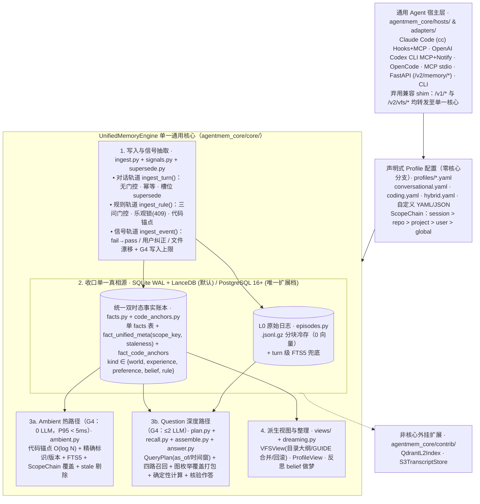

# `agentmem-core` — 通用 Agent 记忆核心（一个核心 + 声明式 Profiles + 通用宿主）

`agentmem-core`（Python 导入 `agentmem_core`，兼容旧名 `memengine`）是一个面向 **LLM 长期对话** 与 **Coding Agent** 的**通用单核双时态记忆引擎**（`UnifiedMemoryEngine`）。

整个系统只有**一个统一核心与单一事实层**，零 `if profile == ...` 分支：对话记忆（`conversational`）、编程记忆（`coding`）与项目混合记忆（`hybrid`）完全通过声明式 YAML 配置（[profiles/](profiles/)）和分层作用域链（`ScopeChain`）驱动，并通过标准 **MCP stdio 服务**与原生宿主适配器支持 **Claude Code (`cc`)、OpenAI Codex CLI (`codex`)、OpenCode** 及任意 MCP/HTTP/CLI 客户端。

> **包名与 API 迁移说明**：为解决历史包名 `memengine` 与 WWW'25 `MemEngine` 重名问题，发行包已正式更名为 `agentmem-core`（导入 `agentmem_core`，CLI `agentmem-core` / `agentmem`，环境变量 `AGENTMEM_CORE_*`）。旧导入 `memengine` 及旧 HTTP 路由 `/v1/*`、`/v2/vfs/*` 均通过透明 shim 转发到单一 `UnifiedMemoryEngine`（返回 `Deprecation: true` 与 `Sunset: 2027-06-01`），详见文末迁移时间表与 [docs/RENAME_PLAN.md](docs/RENAME_PLAN.md)。

---

## 一、核心评测与实测结论（QA 准确率优先，零加权综合分）

> **评测协议与口径声明（G1 & G5）**：
> 1. **无加权综合分**：永久移除历史加权综合分；自建技术专项（`eval/gates/`）已饱和在 100%，**仅作 PASS/FAIL 回归门禁**，绝不计分或对外宣称成绩。
> 2. **冻结评测协议**：所有对话评测参数冻结于 [eval/protocol.yaml](eval/protocol.yaml)（`protocol_version=1.0.0`），强制记录 `extractor_model`、`reader_model`、`judge`、`judge_prompt_version`、`embedder`、`reranker`、`top_k`、`token_budget`、`seeds`、`split`（`dev`/`test` 严格隔离，防过拟合）、`dataset_sha256`、`protocol_sha256`、`commit_hash`。
> 3. **同口径外部参照线声明**：
>    - Hindsight 20B 开源模型口径：LongMemEval `83.6%`、LoCoMo `83.2%`；
>    - Hindsight Gemini-3 Pro 口径：LongMemEval `91.4%`（与 20B 口径不同）；
>    - Hindsight 预印本最高 LoCoMo 口径：`89.61%`（与 20B 口径不同）。
>    - 下表当前运行于**本机离线确定性 CI 轨**（`DeterministicReader` + `deterministic-v1`，零外部 API Key），**严禁与上述在线大模型成绩混比**；接入 20B 开源模型或前沿模型 API 后，用同一 [eval/protocol.yaml](eval/protocol.yaml) 一键出同口径榜单。

### 1. 对话场景：步骤 A 冻结协议三臂基线（`dev` 切分，3 seeds `[42, 137, 2026]`）

对比三条臂：① `full_context`（全上下文无记忆）、② `turn_rrf`（纯 turn 级 BM25+稠密 RRF 地板）、③ `unified`（统一单核 `conversational` profile），完整报告见 [eval/results/step_a_3arm_dev_baseline.md](eval/results/step_a_3arm_dev_baseline.md)：

| 基准 (`split=dev`) | 对照臂 | Seeds | 离线 QA 均值 | Seed 区间 (Min–Max) | Turn R@10 | 平均注入 Token | P95 延迟 |
| :--- | :--- | :--- | ---: | ---: | ---: | ---: | ---: |
| `LongMemEval-S` (n=40/seed) | `full_context` | `[42,137,2026]` | **30.83%** | 25.00%–40.00% | 1.01% | 126,895.0 | 271.79 ms |
| `LongMemEval-S` (n=40/seed) | `turn_rrf`（地板） | `[42,137,2026]` | **35.83%** | 32.50%–40.00% | **79.17%** | 1,651.4 | 1.67 ms |
| `LongMemEval-S` (n=40/seed) | `unified` | `[42,137,2026]` | **30.83%** | 27.50%–35.00% | 72.66% | 2,039.2 | 203.62 ms |
| `LoCoMo` (n=80/seed) | `full_context` | `[42,137,2026]` | **5.00%** | 2.50%–7.50% | 2.86% | 25,048.0 | 88.20 ms |
| `LoCoMo` (n=80/seed) | `turn_rrf`（地板） | `[42,137,2026]` | **9.17%** | 6.25%–12.50% | 38.26% | 384.6 | 0.99 ms |
| `LoCoMo` (n=80/seed) | `unified` | `[42,137,2026]` | **12.92%** | 11.25%–13.75% | **49.87%** | 2,000.7 | 82.91 ms |

- **6 桶归因结论**：`unified` 在 LongMemEval-S `dev` 上 `extraction_miss = 0.00%`、`assembly_truncation = 0.00%`，`73.08%` 的错题来自离线 `DeterministicReader` 推理能力不足（`reasoning_error`），`19.23%` 来自离线字符串裁判噪声（`judge_noise`）；在 LoCoMo 上 `unified` 的 Turn R@10 显著领先 `turn_rrf` 地板 `+11.61 pp`，而在 LongMemEval-S 助理长回复子桶上 `turn_rrf` 的原始轮次直出仍有优势（已定位为步骤 B 接入真实 LLM 后的首要检索优化项）。
- **M0 → M5 历史消融演进**（已裁剪双极渐近环与 recency 平局默认项）：详见 [eval/results/m5_ablation_report.md](eval/results/m5_ablation_report.md) 与 [eval/results/m5_unified_pruned_report.md](eval/results/m5_unified_pruned_report.md)。

### 2. Coding 场景：步骤 C 经验复用、陈旧防误导与误注入评测（G2）

30 对经验复用任务（版本差异 / 项目约定 / 环境报错各 10 对，任务 A 经 C2 `fail_to_pass` 自动捕获并挂 C1 代码锚点，任务 B 经 C3 零 LLM `ambient_context` 召回）+ 10 个代码/依赖变更陈旧陷阱 + 10 个无关干扰项，完整报告见 [eval/results/step_c_coding_eval_report.md](eval/results/step_c_coding_eval_report.md)：

| 指标 | 无记忆 (`no_memory`) | 有记忆 (`coding` profile) | 变化 / 验收判据 |
| :--- | ---: | ---: | :--- |
| 任务 B 成功率（30 对） | 60.00% | **100.00%** | **`+40.00 pp`**（三类坑均 100%） |
| 平均步数 / 任务 | 4.40 | **1.00** | **`-77.3%`** |
| 平均 Token / 任务 | 2,391.7 | **648.7** | **`-72.9%`** |
| 经验自动捕获与修复召回率 | — | **100.00%** (30/30) | C2 自动抽取 + C3 召回 |
| 无关任务误注入率（10 干扰项） | — | **0.00%** (0/10) | 判据 `<= 5%` |
| 代码/版本漂移检测率（10 陷阱） | — | **100.00%** (10/10) | C1 锚点自动标 `stale` |
| 陈旧规则误导率（10 陷阱） | — | **0.00%** (0/10) | `stale_policy=exclude` 零误导 |
| Ambient 路径延迟 / LLM 调用 | — | **P95 3.879 ms / 0 LLM** | 满足 G4 硬约束 |

### 3. 性能、混合场景与回归门禁（G3 / G4 / 步骤 D）

| 验证项 | 规模与内容 | 实测结果 | 证据报告 / 测试 |
| :--- | :--- | :--- | :--- |
| **C3 Ambient 压测 (G4)** | 1,000 条事实/规则/锚点 × 240 次混合查询（挂毒丸 LLM） | **0 LLM 调用** · **P50 2.87 ms / P95 4.892 ms / P99 5.42 ms** · 锚点召回 100% · 陈旧泄漏 0% · 误注入 0% | [c3_ambient_perf_report.md](eval/results/c3_ambient_perf_report.md) |
| **步骤 D 混合场景 (RealMem)** | 2 项目多会话演进：跨对话/coding 用户偏好共享、项目规则覆盖用户偏好、跨仓库隔离、中期升级陈旧剔除、双 profile 并行挂载 | **8/8 PASS (100%)** | [step_d_hybrid_realmem_report.md](eval/results/step_d_hybrid_realmem_report.md) |
| **G3 架构通用契约** | AST + 正则扫描 `agentmem_core/core/` 零 `if profile == ...`；单表双 profile 契约；`/v1/*` & `/v2/vfs/*` 零独立表真转发 | **PASS**（核心 0 分支） | [test_universal_profiles_and_scopes.py](tests/test_universal_profiles_and_scopes.py) |
| **自建专项门禁** | 精确标识符 120 题 + 版本号 80 题 + 日历 60 题 + 抗压长程 | **PASS / FAIL 门禁（100% PASS，不计综合分）** | `python3 -m eval.gates.run_gates` |

---

## 二、架构总览：一个通用核心 + 声明式 Profiles + 通用宿主



### 后端收口策略

- **默认核心后端**：`SQLite WAL + FTS5`（内置零依赖）与 `LanceDB`（嵌入式零拷贝 ANN，可选 `[lance]`）。
- **唯一横向扩展档**：`PostgreSQL 16+`（`pgvector` / `vchordrq` + `tsvector`，可选 `[postgres]`）。
- **移出核心**：Qdrant（`agentmem_core/contrib/qdrant.py`）与 S3 冷存（`agentmem_core/contrib/s3_transcripts.py`）作为非核心 contrib 扩展，核心对其零依赖。

---

## 三、快速开始与通用宿主接入（保留 Claude Code `cc`、Codex、OpenCode、MCP）

### 1. 安装

```bash
pip install -e ".[dev]"       # 核心（Python 3.10+、NumPy、SQLite WAL/FTS5、MCP stdio、CC/Codex 宿主）
pip install -e ".[lance]"     # + 嵌入式 LanceDB
pip install -e ".[postgres]"  # + PostgreSQL 16+ 横向扩展
pip install -e ".[server]"    # + FastAPI HTTP 服务
pip install -e ".[all]"       # 全部可选依赖
```

### 2. 一键接入通用 Coding Agent 宿主（MCP + Hooks）

```bash
# Claude Code (cc)：自动写入 .mcp.json + .claude/settings.local.json (UserPromptSubmit / PostToolUse / Stop)
agentmem-core host install cc --repo-root /path/to/your/repo --user-id alice

# OpenAI Codex CLI (codex)：自动写入 .codex/config.toml [mcp_servers.agentmem] 并输出 AGENTS.md 片段
agentmem-core host install codex --repo-root /path/to/your/repo --user-id alice

# OpenCode：自动写入 opencode.json
agentmem-core host install opencode --repo-root /path/to/your/repo --user-id alice

# 任意标准 MCP 客户端直接启动 stdio MCP Server
agentmem-core --db-url /path/to/memory.db mcp-serve --profile coding --repo-id my-repo --repo-root /path/to/your/repo
```

### 3. 单核同时挂载对话 + Coding 双 Profile（Python SDK）

```python
from agentmem_core import AgentEvent, UnifiedMemoryEngine

engine = UnifiedMemoryEngine("memory.db")

# 同一核心同时挂载 conversational 与 coding 两个声明式 profile，写入与检索互不干扰
chat = engine.bind_profile("conversational", user_id="alice", session_id="chat-1")
coder = engine.bind_profile("coding", user_id="alice", repo_id="payments", project_id="billing", session_id="code-1")

# 1) 用户全局偏好在对话与 coding 间共享
chat.ingest_turn("I prefer concise bullet answers and pytest.", scope_key="user:alice")

# 2) 项目/仓库规则优先覆盖用户全局偏好，且挂代码锚点防止代码变更后误导
coder.ingest_rule(
    "/prefs/test_runner.md",
    title="Payments Test Runner",
    trigger_condition="Running unit tests in payments",
    action="Run `uv run pytest -m unit`",
    verification_result="All unit tests green",
    override_key="test_runner",
    anchors=["pyproject.toml"],
    repo_root=".",
)

# 3) 失败转成功事件自动抽取规则 + 锚点（受 G4 写入成本上限约束）
coder.ingest_event(AgentEvent(event_type="test_result", command="pytest", exit_code=1, text="OperationalError: database is locked", file_paths=("src/db.py",)))
coder.ingest_event(AgentEvent(event_type="file_edit", text="Enable WAL + busy_timeout=5000", file_paths=("src/db.py",)))
coder.ingest_event(AgentEvent(event_type="test_result", command="uv run pytest", exit_code=0, text="passed", file_paths=("src/db.py",)))

# 4) C3 零 LLM 毫秒级 ambient 上下文注入（P95 < 5ms，llm_calls == 0）
amb = coder.ambient_context("database is locked", active_files=["src/db.py"])
assert amb["llm_calls"] == 0

# 5) 代码变更后自动将漂移规则标记为 stale（coding profile 默认排除陈旧规则）
coder.verify_anchors(repo_root=".")
```

---

## 四、可复现评测与三层 CI 命令

### 三层 CI 架构（`.github/workflows/`）

- **PR 快速门禁**（[ci.yml](.github/workflows/ci.yml)）：全量单测、G3 双 profile 契约与零分支校验、精确标识符/版本/日历/抗压门禁、Step C 编码复用门禁、Step D 混合场景门禁。
- **每晚中等规模评测**（[eval-nightly.yml](.github/workflows/eval-nightly.yml)）：含长程 100K 门禁、C3 1,000 事实 Ambient P95 压测、Step C 与 Step D 完整报告产物上传。
- **每周 / 发版全量评测**（[eval-weekly.yml](.github/workflows/eval-weekly.yml)）：支持通过 `workflow_dispatch` 传入真实 `llm_model`（如 20B 开源模型或前沿模型）、`extractor_model`、`judge_model` 在冻结 [eval/protocol.yaml](eval/protocol.yaml) 上执行多 seed 评测。

### 本地一键运行命令

```bash
# 1. 全量单测 + 契约测试 + C1/C2/C3 + MCP/CC/Codex 宿主测试
python3 -m pytest -q

# 2. 确定性 PASS/FAIL 回归门禁
python3 -m eval.gates.run_gates

# 3. C3 零 LLM Ambient 毫秒级压测
python3 -m eval.ambient_perf_bench --facts 1000 --queries 240

# 4. 步骤 C Coding 经验复用 / 陈旧陷阱 / 误注入评测
python3 -m eval.coding.run_coding_eval

# 5. 步骤 D 混合场景 (RealMem-style) 评测
python3 -m eval.hybrid.realmem_eval

# 6. 步骤 A 冻结协议三臂基线（dev 切分 3 seeds；接入真实 LLM/Judge 只需追加 --llm-model / --extractor-model / --judge-model）
python3 -m eval.qa.run_qa \
  --protocol eval/protocol.yaml \
  --engines full_context turn_rrf unified \
  --benchmarks longmemeval locomo \
  --split dev --seeds 42 137 2026 \
  --out eval/results/step_a_3arm_dev_baseline.json
```

---

## 五、迁移指南与弃用时间表

| 遗留接口 / 名称 | 推荐替代 | 当前状态 | 计划移除时间 |
| :--- | :--- | :--- | :--- |
| `import memengine` / `memengine` CLI / `MEMENGINE_*` | `import agentmem_core` / `agentmem-core` CLI / `AGENTMEM_CORE_*` | 兼容 shim（发出 `DeprecationWarning`） | `v1.0.0` |
| HTTP `/v1/*` | HTTP `/v2/memory/*`（由 `UnifiedToolRegistry` 统一派生） | 转发至 `UnifiedMemoryEngine`，带 `Deprecation: true` 与 `Sunset` 头 | `2027-06-01` |
| HTTP `/v2/vfs/*` | HTTP `/v2/memory/*` + `profile="coding"` | 默认转发至 `UnifiedMemoryEngine.vfs`（零独立 `vfs_nodes` 表） | `2027-06-01` |
| `enable_bipolar=True` / `enable_recency_rerank=True` | 默认均已关闭（经 M5 消融证实关闭后 QA 零下降、MRR 上升） | 仅保留为显式可选 feature flag | `v1.0.0` 评估清理 |
