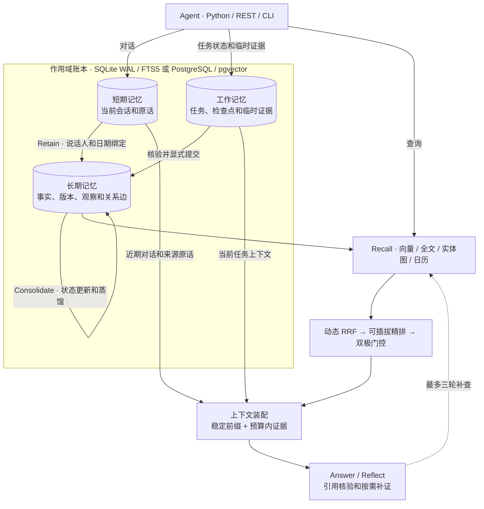

# 认知记忆引擎

面向 Agent 的记忆引擎，提供短期会话、任务工作区和长期账本。原话、发生时间与版本修订都可追溯，检索证据按 Token 预算送入模型。

## 架构



- **存储与隔离**。SQLite 用 WAL、FTS5 和增量向量缓存。PostgreSQL 用 pgvector、tsvector 和 pg_trgm，支持数组向量降级。读写按用户、Agent 和会话限定作用域。
- **Retain 与 Consolidate**。原话独立保存。规范实体、提及时间、发生区间和属性槽进入双时态账本。覆写保留修订链，新证据使相关观察进入待刷新状态。
- **Recall**。四路候选经动态加权 RRF 融合，重构模式可沿关系边扩散两跳并补查桥接证据。版号与精确标识符独立校验。双极渐近环提高单次关键事实和反复巩固事实的权重，并压缩中间层。
- **Answer 与 Reflect**。稳定前缀上限为 360 Token，动态区装入本轮证据、必要原话与任务上下文。作答与反思核验来源和有效性。长期写入由显式 Retain 或已核验的任务提交触发。

完整公式、边界条件和存储契约见 [设计说明](docs/DESIGN.md)。原始提案和历史目标见 [规格](docs/SPEC.md)。

## 安装与接口

```bash
pip install -e ".[dev]"
```

需要 Python 3.10+、NumPy；单测使用 pytest。

```python
from memengine import CognitiveMemoryEngine

engine = CognitiveMemoryEngine(db_path="memory.db", categories=["基础设施"])
scope = {"user_id": "alice", "agent_id": "assistant"}
written = engine.add("老周对苯甲酸钠过敏。", **scope, session_id="chat-1", role="user")
query = "老周对哪种防腐剂过敏？"
evidence = engine.retrieve(query, **scope, top_k=10, token_budget=2048)
print(engine.answer(query, **scope, retrieved=evidence)["response"])
engine.delete(written["operations"][0]["line_id"], **scope)  # 软删除，保留审计记录
```

- `search()` 兼容 `retrieve()`。可按 `session_id` 过滤；默认跨当前用户/Agent 的会话检索。
- `add(..., event_time=...)` 可单独记录事件发生时间。`sync=False` 仍先保存原文，事实抽取和索引进入进程内队列。非只读任务检索默认先刷本租户队列，可设 `flush_pending=False`。只读查询使用 `read_only=True`。
- `buffer_turn()` 同步将原话以 `buffered` 态入库并返回轮次 ID。`get_recent_turns()` 与兼容接口 `working_memory()` 读取近期原话。`retain(buffered_turn_id=...)` 和 `flush_session()` 使用原轮次，提取成功后转为 `done`。
- `remember()` 可显式写入事实和带触发条件的执行规则，需要同会话原文 ID 或 `record_tool_call()` 注册的来源。`forget()` 支持按 ID 或查询删除。
- `consolidate()` 显式运行离线蒸馏，默认至少有 8 条新增活跃事实才执行。`decay_and_archive()` 执行选择性衰减和归档。`retrieve(..., include_cold=True)` 可召回冷库证据，时间回溯也可打开时间通道的冷记录。
- `retrieve(..., include_raw_turns=True)` 返回前三条事实的原文及同会话相邻轮，字段为 `drilldown_turns`。
- `build_context(query, **scope, token_budget=4096, drilldown_top_n=2, drilldown_window=0)` 先装配原子事实，再用剩余预算钻取新信息。`token_breakdown` 分列 `prefix_tokens`、`facts_tokens`、`drilldown_tokens` 和 `total_injected_tokens`。无快照时前缀为空，有快照时重复读取保留相同字节与指纹。前缀预算不足时抛出 `ValueError`。
- `timestamp` 仅对当前调用生效。固定时钟用 `set_time()`；恢复用 `reset_clock()`。
- `delete(..., hard=True)` 删除事实版本链及实体、全文和向量索引。独立原文日志、备份和外部服务留存需要分别处理。

### Agentic Search

```python
tools = engine.as_tools(user_id="alice", agent_id="assistant", session_id="chat-1")
# tools 可直接作为 Chat Completions 的 tools 数组
# MCP 工具清单用 tools.mcp_definitions()
matches = tools.dispatch_tool("memory_search", {"query": "过敏禁忌", "memory_types": ["fact"], "top_k": 5})
if matches and matches[0]["source_turn_ids"]:
    raw = tools.dispatch_tool("memory_drilldown", {"turn_ids": matches[0]["source_turn_ids"][:40]})
```

`memory_history` 按实体或记忆 ID 查版本链。`memory_remember` 需要同作用域原文 ID 或宿主注册的 `tool_call_id`，后者经执行器关键字传入。`memory_forget` 必须明确指定记忆 ID。宿主可用 `engine.dispatch_tool(..., user_id=..., agent_id=..., session_id=...)` 直接执行。作用域来自宿主，工具参数无权更改。

## 模型配置

默认 LLM 是确定性 `MockLLMClient`。要启用 Live，可以把 `OpenAICompatibleClient()` 传给 `llm=`，或使用 `build_llm_from_env()` 选择客户端。

| 环境变量 | 含义 |
| --- | --- |
| `LLM_BASE_URL` | Chat 接口根路径，默认 `https://api.openai.com/v1`。 |
| `LLM_API_KEY` / `OPENAI_API_KEY` | Chat 接口密钥。 |
| `LLM_MODEL` | Chat 模型名，默认 `Qwen2.5-7B-Instruct`。 |
| `EMBEDDING_BASE_URL` / `EMBEDDING_MODEL` | 同时设置时启用 OpenAI 兼容 `/embeddings`。 |
| `EMBEDDING_API_KEY` | 若向量服务需要鉴权，设置此密钥。 |
| `RERANK_BASE_URL` / `RERANK_MODEL` | 同时设置时，向 `/rerank` 提交问题和候选事实文本。 |
| `RERANK_API_KEY` | 可选的精排服务 Bearer 密钥。 |
| `LOCAL_EMBED_MODEL` | 本机向量模型名。ONNX 默认为 `sentence-transformers/paraphrase-multilingual-MiniLM-L12-v2`。 |
| `LOCAL_RERANK_MODEL` | 本机 Cross-Encoder 模型名。ONNX 默认为 `Xenova/ms-marco-MiniLM-L-6-v2`。 |
| `LOCAL_NEURAL_THREADS` | 单个 FastEmbed ONNX 会话的线程数。并行评测时可设为 `1`。 |
| `LOCAL_EMBED_MODEL_PATH` / `LOCAL_RERANK_MODEL_PATH` | 已下载的 FastEmbed 模型目录，保留模型仓库的文件结构。 |
| `HF_ENDPOINT` / `HF_HUB_OFFLINE` | Hugging Face 镜像地址和仅使用本地缓存的开关。 |
| `LOCAL_NEURAL_DEVICE` | Sentence Transformers 的设备覆盖，如 `cpu`、`mps` 或 `cuda`。 |

未配置远程服务时，向量通道使用本地 `HashedTfidfEmbedder`。远程编码在写入时失败，则保存本地向量。查询只计算能成功编码且模型和维度相符的向量。指定 `vector=` 可替换向量后端。FTS5、实体和时间索引始终可用。

默认词面精排保留低分证据。紧凑模式下，Cross-Encoder 的绝对阈值默认为 `0.18`，可通过 `tau_abs`、`cliff_ratio`、`allow_empty_recall` 调整。预算模式融合神经和确定性分数，通过有无检索信号决定是否空返。精确标识符可绕过绝对阈值。

```bash
python3 -m pip install -i https://pypi.tuna.tsinghua.edu.cn/simple -e ".[dev,onnx]"
HF_ENDPOINT=https://hf-mirror.com python3 -m eval.exact_ident_eval --legacy --backend local-neural --out /tmp/exact-onnx.json
```

`--backend local-neural` 优先加载 FastEmbed 的 ONNX 模型组合，失败后尝试已安装的 Sentence Transformers 组合。显式选择该后端要求两种组件均能加载。`--backend auto` 会报告实际后端和降级原因。缓存离线复现可直接指定模型目录。

```bash
HF_HUB_OFFLINE=1 LOCAL_EMBED_MODEL_PATH=/path/to/embedding LOCAL_RERANK_MODEL_PATH=/path/to/reranker   python3 -m eval.exact_ident_eval --legacy --backend local-neural --out /tmp/exact-onnx.json
```

## 测试与评测

```bash
python3 -m pytest -v
python3 -m eval.exact_ident_eval --backend hashed --out /tmp/exact-ident.json
python3 -m eval.run_eval --scale small
python3 -m eval.membench.run --sample 25 --mode mock --data-dir /path/to/MemData --out /tmp/membench.json
python3 -m eval.bipolar_ablation stress --out /tmp/bipolar-stress.json
python3 -m eval.bipolar_ablation membench --data-dir /path/to/MemData --cohort-only --reference /path/to/previous-99.json --out /tmp/bipolar-membench.json
python3 -m eval.stress_precision --mode mock --sample 20 --seed 42 --out /tmp/stress-precision.json
```

阶段 A 跨版本比较可在 MemBench 命令加 `--phase-a --reference /path/to/previous-membench.json`。它先核对题目与证据集，再报告四路模式相对于此前双路 RRF 的变化。

合成评测比较朴素 RAG、自写 CRUD、关闭时间轴缓冲与闲聊旁路的消融版本，以及完整链路。准确率按关键词和禁用词计，陷阱幻觉率单独统计；检索 P95 不含 System 2 作答。`--mode auto` 有 Chat 密钥时走 Live，否则走 mock。规格中的目标，以及 `eval/results/small_eval.*` 中重构前的归档结果，都不是这版运行的成绩。

MemBench 使用官方 `import-myself/Membench` 仓库的 `MemData` 分类文件，不是论文里的 `data2test` 加噪集。`--sample` 是每个大类的数量；首次运行需要下载，离线机器可用 `--data-dir` 指向预置数据。检索和 System 2 只看题干，选择题适配器将自然语言答案映射为选项。另外比较同一作答头下的检索证据、无记忆、全上下文，并报告证据 step 的 Recall@10。Mock 评测验证流程，不代表语言模型准确率；旧 `sample20_mock.*` 为历史归档。

### 配对证据评测

```bash
python3 -m eval.locomo.run --mode mock --sample 100 --seed 42 --data-dir /path/to/locomo10.json --out /tmp/locomo.json
python3 -m eval.longmemeval.run --mode mock --sample 100 --seed 42 --data-dir /path/to/longmemeval_s_cleaned.json --out /tmp/longmemeval.json
```

`--sample` 是总题数，按题型轮流分层抽样。省略 `--data-dir` 时使用各模块的 `.cache/`，缺文件才下载。离线环境可放置 [LoCoMo JSON](https://raw.githubusercontent.com/snap-research/locomo/main/data/locomo10.json) 和 [LongMemEval-S cleaned JSON](https://huggingface.co/datasets/xiaowu0162/longmemeval-cleaned/resolve/main/longmemeval_s_cleaned.json) 后执行上述命令。报告记录源 URL、SHA-256 和验证状态。未验证输入会明确标为非官方成绩。

官方三套及压力评测支持 `--mode mock` 和 `--mode live`。配对组共享同次召回，使用 Top-10 与 2048 Token 预算。Pure RRF 使用通用四路排序，Full System 可另用精确标识符通道。`--consolidate` 固定事实召回，单列最多 360 Token 的静态前缀预算，并测量去重后的 Observation 和前缀指纹复用。

### 零 API 静态矩阵

全量 LoCoMo 1,986 题的 Evidence Recall@10 为 50.06%，平均注入 473.1 Token。LongMemEval-S 500 题的 Evidence Recall@10 为 70.87%，更新支配 42/70（四路 RRF 37/70）。MemBench 缓存扩样 400 题的 Evidence Recall@10 为 77.80%。130 项测试和冻结门禁均通过。[完整静态报告](eval/results/static_benchmark_report.md)

在仓库根目录运行，传入三套本地数据和上一轮的 99 题参考 JSON。该入口顺序执行冻结回归和五维评测，将未截断的日志、退出码及 JSON/Markdown 输出写入指定目录。`exact_ident_eval` 默认运行 120 题，`--legacy` 保留原 40 题入口。

```bash
bash scripts/run_static_matrix.sh /path/to/results /path/to/locomo10.json \
  /path/to/longmemeval_s_cleaned.json /path/to/MemData /path/to/previous-99.json
```

- LoCoMo 依发布文件与 [官方评测代码](https://github.com/snap-research/locomo/blob/main/task_eval/evaluation.py) 标注：1 多跳、2 时间、3 开放域、4 单跳、5 对抗。对抗题的「噪声泄漏」指存在不与标注证据轮次相交的检索事实；冗余 Token 只计算这些事实。它不是生成式拒答准确率，也不把陷阱答案当金标。
- LongMemEval-S 另报会话级证据。`has_answer` 和 `answer_session_ids` 只在打分时使用；写入用不含答案标记的会话标识。`_abs` 单独分桶。更新支配率评估可识别的官方旧/新版本对，按排名、可验证的版本归档或生效的旧版本降权判定。
- 默认软裁剪不是强制压缩。保留预设阈值先复跑压力集；压缩或 MRR 未领先时命令报告未达标，不改对照组或事后替换样本。

## Retain / Recall / Reflect 服务

默认使用 SQLite。可通过构造参数 `db_url`、CLI 的 `--db-url` 或 `MEMENGINE_DB_URL` 选择后端：

- **SQLite**：接受 `:memory:`、文件路径与 `sqlite:///relative.db`。
- **SQLite + LanceDB（Rust + Apache Arrow 嵌入式混合模式）**：接受 `lancedb:///path/to/dir`、`lance:///path/to/dir` 或 `sqlite+lance:///path/to/ledger.db`。SQLite 负责强 ACID 双时态账本与关系图，LanceDB 接管磁盘零拷贝向量检索与 RaBitQ (`IVF_RQ`) 量化 ANN（超阈值自动建索引，亦支持 `store.optimize_index()`），无须外部服务即可缓解大库查询发热与内存抖动。
- **PostgreSQL 16+（服务端单库多模模式）**：接受 `postgresql://` 与 `postgres://`。启动时按能力自动升级：**向量层**优先 `vchordrq`（VectorChord RaBitQ）→ `diskann`（pgvectorscale）→ `hnsw`（pgvector）→ SQL 数组点积；**词法层**优先 `pg_search`（ParadeDB Tantivy BM25）→ `vchord_bm25`（VectorChord Block-Max WAND BM25）→ `tsvector` GIN。`docker-compose.yml` 默认使用 `tensorchord/vchord-suite:pg16-latest`，可用 `MEMENGINE_PG_IMAGE` 切换为 `paradedb/paradedb:latest` 或 `pgvector/pgvector:pg16`，`/health` 返回当前生效引擎。

```bash
pip install -e '.[dev]'
python3 -m memengine.cli --db-url ./memory.db init-db
python3 -m memengine.cli --db-url ./memory.db retain '拔牙后一周内禁饮咖啡。' --ttl-seconds 604800
python3 -m memengine.cli --db-url ./memory.db recall '最近喝咖啡有什么限制？' --mode reconstructive
python3 -m memengine.cli --db-url ./memory.db reflect --force
python3 -m memengine.cli --db-url ./memory.db retain 'I moved to Shanghai yesterday.' \
  --mention-time 2025-05-08 --speaker 'Alice Chen'
python3 -m memengine.cli --db-url ./memory.db recall 'When did Alice move to Shanghai?' \
  --reference-time 2025-05-10 --mode reconstructive --token-budget 2048
python3 -m memengine.cli --db-url ./memory.db reflect --query 'How long ago did Alice move to Shanghai?' \
  --reference-time 2025-05-10
pip install -e '.[all]'
MEMENGINE_DB_URL=./memory.db MEMENGINE_API_KEY=your-key memengine serve
```

`[lance]` 安装嵌入式 LanceDB 与 PyArrow，`[postgres]` 安装数据库驱动与连接池，`[server]` 安装 FastAPI 和 Uvicorn，`[all]` 包含全部三组。容器部署可复制 `.env.example` 为 `.env`，填入密码和 API Key，再执行 `docker compose up --build`。Bearer Key 是服务级凭据，调用方须可信并负责其租户映射。

| 方法 | 路径 | 输入与输出 |
| --- | --- | --- |
| POST | `/v1/retain` | `text` 或 `turns`。每轮可传 `mention_time`、`speaker`。显式事实可传 `epistemic_scope`、`confidence`、`source_turn_ids`、`expires_at` 或 `ttl_seconds` |
| POST | `/v1/recall` | `query`、`reference_time`、`mode`、`scopes`、`time_start/end`、`include_cold`、`top_k`、`token_budget`、`packing_mode`。`assemble=true` 返回前缀与动态区。耗时见 `X-Retrieval-Ms` |
| POST | `/v1/answer`、`/v1/reflect` | 传 `query` 和可选的 `task_id`，返回核验通过的断言与证据编号 |
| POST | `/v1/consolidate` | 显式蒸馏，默认同时执行冷热归档 |
| POST | `/v1/turns/buffer`、`/v1/tasks` | 持久化近期会话，或创建任务工作区 |
| POST | `/v1/tasks/{id}/workspace`、`/checkpoint`、`/resume` | 获取任务、保存检查点或恢复执行 |
| POST | `/v1/tasks/{id}/items`、`/items/{item_id}/verify`、`/commit` | 暂存、核验及显式晋升任务结论 |
| POST | `/v1/drilldown` | 通过 `turn_ids`、`window` 读原话 |
| GET / DELETE | `/v1/history/{target}` / `/v1/memories/{id}` | 查看版本链或遗忘 |
| GET / POST | `/v1/tools/schema` / `/v1/tools/dispatch` | 导出工具协议或执行工具 |
| GET | `/health` | 当前数据库、索引能力与降级状态 |
| GET / POST | `/v2/vfs/health`、`/transcripts`、`/write`、`/write-rule` | v2 VFS 健康检查、L0 分块日志写入、Markdown 节点与显著性门控规则写入（乐观锁冲突返回 HTTP 409） |
| POST | `/v2/vfs/tree`、`/read-note`、`/search`、`/context`、`/compact`、`/rollback` | Stage 2 目录导航、`read_note` 渐进式披露拉取、Stage 3 三阶段混合检索、目录合并重构与原子批次回滚 |
| GET / POST | `/v2/vfs/tools/schema` / `/v2/vfs/tools/dispatch` | 导出 12 个 Claude 风格 VFS 工具（OpenAI / MCP）或执行工具调用 |

## v2 虚拟文件系统记忆引擎（`VFSMemoryEngine`）

面向强模型的下一代分层混合记忆架构，融合**关系型元数据与状态机（SQLite / PostgreSQL `memory_nodes`）+ 虚拟文件系统（L1/L2/L3 Markdown 树）+ 仅 L2 向量/BM25/精确标识符索引（pgvector / VectorChord / Qdrant / LanceDB `IVF_RQ`）+ 解耦 L0 分块日志（本地 JSONL.GZ / S3）**：

- **三阶段混合检索**：Stage 1 强制预加载（L1 `/global.md` + L2 `always_active`）→ Stage 2 结构化目录导航（`tree_outline()` `ls -R` + `read_note(path)`）→ Stage 3 混合语义 + 元数据过滤 + 公式重排（`Final Score = Semantic_Sim * W_verified * W_recency`，嫁接 L2 精确标识符与版本分级零串台门禁）。
- **高密度输出与渐进式披露**：写入端三问显著性门控与 `[触发条件] + [动作] + [验证结果]` 假设/规则状态机；读取端以 `<=50` 字 `index_summary` 替代粗暴硬截断，单目录超过 `10` 条或 `3,000` Tokens 时可调用 `compact_directory()` 原子重构为单份 `GUIDE.md` 并支持 `rollback_batch()` 整批回滚。
- **快速使用**：

```python
from memengine import VFSMemoryEngine

# 支持 SQLite（默认）、lancedb:///path（嵌入式 RaBitQ ANN）、postgresql://...
vfs = VFSMemoryEngine("lancedb:///tmp/agent_vfs")
vfs.write("/global.md", title="Global", content="变更数据库前必须执行演练。", layer="L1", verification_status="verified")
vfs.write_rule(
    "/strategies/db/rabitq.md",
    title="L2 仅索引精炼笔记",
    trigger_condition="构建高规模 Agent 记忆检索",
    action="仅向量化 L2 Markdown 规则，L0 原始对话按块落冷存",
    verification_result="10K 压测 CPU 下降 70%",
    always_active=True,
)
ctx = vfs.build_context("如何防止大库向量检索发烫？", disclosure="progressive")
```

CLI 同样内置 `memengine vfs {health,tree,read-note,write-rule,search,context,compact}`。完整存储优化、账本/SQLite 消融与三阶段检索实测报告见 [存储优化与 VFS 消融实测报告](eval/results/ablation_storage_and_vfs_report.md)。

`MemoryClient(url, api_key=...)` 提供同名六个操作，使用 Python 标准库。有效期为左闭右开。日历发生区间独立记录，按 UTC 解析并用于区间召回。显式按认知域筛选时仅注入对应证据。传 `token_budget` 且省略 `top_k` 可按预算装填至多 60 条候选。开启 `reconstructive` 后，两跳关系图与桥接召回共享最终预算。架构和验证见 [设计文档](docs/DESIGN.md#真实日历版本与记忆闭环)。

### 日历、版本与关系图评测

以下零 API 命令使用官方 JSON，验证文件的 SHA-256，再按原始日期和说话人写入。两种模式共用 2,048 Token 预算。`Recall@10` 计前十条已装配事实，`Recall@Budget` 计预算内全部已装配事实。

```bash
python3 -m eval.chrono_eval --out /tmp/chrono.json
python3 -m eval.version_precision_eval --out /tmp/version-precision.json
python3 -m eval.locomo.run --chronicle --all --seed 42 --workers 4 \
  --data-dir /path/to/locomo10.json --out /tmp/locomo-chronicle.json
python3 -m eval.longmemeval.run --chronicle --all --seed 42 --workers 4 \
  --data-dir /path/to/longmemeval_s_cleaned.json --out /tmp/longmem-chronicle.json
```

分题型结果、两个召回口径、图扩散消融和 10K SQLite 实测见 [本轮实跑报告](eval/results/chronicle_report.md)。历史双数据库结果见 [双数据库实跑报告](eval/results/dual_backend_report.md)。

### 检索失分诊断

[失分报告](eval/results/failure_autopsy.md) 记录全量官方队列的原话覆盖、事实溯源覆盖、候选 @100/@50/@20、最终 @10、预算覆盖和逐通道贡献。

```bash
python3 -m eval.failure_autopsy locomo --data /path/to/locomo10.json \
  --workers 4 --out /tmp/locomo-funnel.json
python3 -m eval.failure_autopsy locomo --data /path/to/locomo10.json \
  --ingest chronicle --ablate --workers 4 --out /tmp/locomo-ablated.json
```

`--ingest chronicle` 透传说话人与时间锚点，使用预算装填。它默认运行重构检索，也可用 `--query-mode single_query` 明确选择单次检索。完整入口同时支持 `longmemeval`、`membench99` 和 `membench`。使用已校验的本地模型时，设置模型目录、`HF_HUB_OFFLINE=1` 和 `--backend local-neural`。应用可调用 `memengine.neural.load_local_backends()`，将返回的向量编码器与精排器传给 `CognitiveMemoryEngine(vector=..., reranker=...)`。见 [检索对齐实测](eval/results/retrieval_alignment.md)。

本轮 150 项测试通过，冻结门禁退出码为 0。LoCoMo 1,986 题 Recall@10 为 57.95%（单路）和 57.79%（图模式），多跳题的同预算 Recall 为 51.15% 和 53.52%。LongMemEval-S 500 题 Recall@10 为 70.84% 和 66.77%。10K SQLite 缓存检索 P95 为 80.417 ms。

### 工作区与作答验收

用 Python 3.12 执行以下命令。将 `BASELINE_REPO` 指向改造前源码，将 `BASELINE_RESULTS` 指向同协议的冻结检索结果。先在输出目录生成完整评测矩阵。

```bash
python3 -m eval.evidence_ablation --baseline-repo "$BASELINE_REPO" --out "$RESULTS/answer-evidence.json"
python3 -m eval.engineering_bench --baseline-repo "$BASELINE_REPO" --out "$RESULTS/paired-10k.json"
python3 -m eval.regression_guard --results "$RESULTS" --baseline-results "$BASELINE_RESULTS"

docker compose up -d --build
python3 -m scripts.smoke_workspace_compose
```

容器冒烟使用环境中的 `MEMENGINE_API_KEY`，检验工作区和会话在应用容器重启后的恢复，以及显式提交后的跨会话召回。
