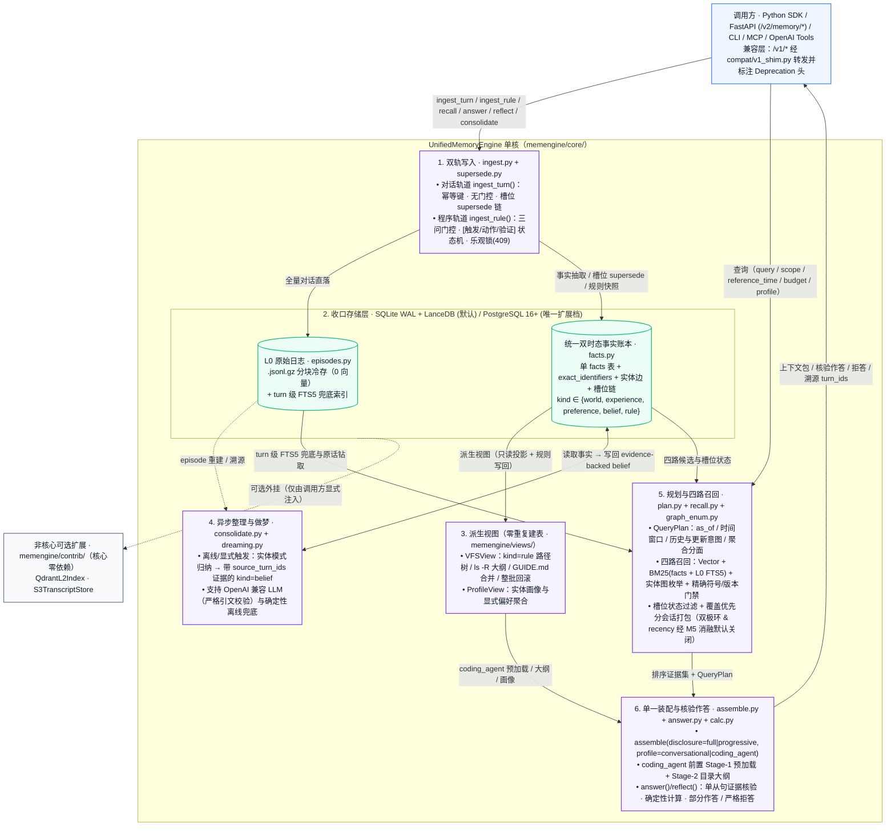

# Agent Memory Engine（统一单核双时态记忆引擎）

面向强模型 Agent 的单核混合记忆引擎（`UnifiedMemoryEngine`），以**统一真相源、同口径端到端评测与实证消融驱动**为核心原则，将历史双引擎收口为一套清晰架构：

- **双轨写入 + 单真相源存储**：对话轨道（`ingest_turn`）无显著性门控，直落 L0 分块冷存（`.jsonl.gz`，**0 向量化**）并建 turn 级 FTS5 兜底，同时抽取事实写入统一双时态事实账本（`facts`，`kind ∈ {world, experience, preference, belief, rule}`）；程序性轨道（`ingest_rule`）走三问显著性门控、三段式状态机与行级乐观锁（冲突 409）。存储层收口为 **SQLite + LanceDB（默认）** 与 **PostgreSQL 16+（唯一横向扩展档）**，Qdrant / S3 移出核心至 `memengine/contrib/`。
- **派生视图零冗余**：VFS 目录树与 `GUIDE.md` 合并（`VFSView`）、实体画像（`ProfileView`）均直接派生于统一事实表，**不再单独维护第二份事实表**。
- **四路召回 + 槽位更新 + 实体图覆盖打包 + 反思做梦**：并行融合向量、BM25（含 L0 FTS5 兜底）、两跳实体图与精确标识符/8 类版本零串台通道；叠加 M2 槽位级 supersede / `as_of` 时间窗口、M3 实体图分面枚举 / 覆盖优先打包 / 确定性计算器（`count`/`sum`/`diff`/`date_diff`）、M4 带证据引用的反思型 `kind='belief'` 做梦蒸馏。经 M5 端到端消融实测，**双极渐近环与 `W_verified × W_recency` 平局裁决已默认关闭**（仅保留为可选 feature flag）。
- **单工具注册表 + 兼容层**：`UnifiedToolRegistry` 统一派生 HTTP（`/v2/memory/*`）、CLI、MCP 与 OpenAI Tools；旧 `/v1/*` 保留兼容 shim 并返回 `Deprecation: true` / `Sunset` 响应头。

> **包名迁移说明**：当前 PyPI / Python 包名 `memengine` 与 WWW'25 `MemEngine` 存在命名冲突。M5 阶段保持 100% 向后兼容不破坏现有导入，已准备零停机双阶段更名方案（推荐 `chronomem`），详见 [docs/RENAME_PLAN.md](docs/RENAME_PLAN.md)。

---

## 系统架构图

下图严格对应仓库现有代码（`memengine/core/`、`memengine/views/`、`memengine/adapters/`、`memengine/compat/`、`memengine/storage/`），无占位或虚构模块：



### 能力边界清单（已实测 vs 仅单测适配 vs 非内置）

| 状态 | 范围说明 |
| :--- | :--- |
| **已实现并实机实测** | `UnifiedMemoryEngine` 单核全链路（SQLite WAL + FTS5、LanceDB `IVF_RQ`、Docker PostgreSQL 16 `pgvector`+`tsvector`、L0 `.jsonl.gz` + turn 级 FTS5、槽位 supersede、实体图分面枚举、覆盖优先打包、确定性计算器、`dream_beliefs`、`VFSView`、`ProfileView`、`UnifiedToolRegistry` 派生的 `/v2/memory/*` / CLI / MCP / OpenAI Tools、`/v1/*` 弃用 shim）；端到端 QA 评测与 6 桶归因框架（`eval/qa/`）及 4 项 PASS/FAIL 回归门禁（`eval/gates/`）。 |
| **已写代码适配（仅单测）** | `memengine/contrib/` 中的 `QdrantL2Index`（REST）、`S3TranscriptStore`（boto3）；PostgreSQL `vchordrq` / `diskann` / `pg_search` / `vchord_bm25` 自动探测 SQL 分支；在线 OpenAI 兼容 Reader / Judge / Dreaming LLM 客户端（已通过 HTTP mock 单测，本机无外部 API Key 时自动运行离线确定性后端）。 |
| **不在引擎内部实现（需外部提供）** | ① 后台常驻定时做梦/压缩守护进程（需外部显式调用 `consolidate()` / `compact_directory()`）；② 内置在线大模型推理能力（无 API Key 时仅使用离线确定性 Reader/Extractor，无法替代真实 20B/前沿 LLM 的语义泛化）；③ 自动 Agent 工具调用循环。 |

---

## 评测体系与 M0 → M5 实测演进

> **严正评测口径声明（彻底移除加权综合分）**：
> 1. 本仓库**已永久删除历史加权综合分**（原 `compute_weighted_summary`），不再混合不同粒度指标。
> 2. 跨引擎检索对比**统一使用 Turn / Step 级召回（`Turn R@10` / `MRR@10`）作为主指标**，Session 级召回仅作辅助参考。
> 3. 下表离线实测全部使用 **`HashedTfidfEmbedder` + `CalibratedLocalReranker` + `MockLLMClient/DeterministicReader` + `deterministic-v1 / exact-mcq-match` 裁判**（完整 provenance 见每份报告 JSON/MD）。**离线确定性分数不可直接与使用真实前沿 LLM 的外部论文成绩（如 Hindsight）作横向对比**；如需对标，请使用下方 `--llm-model` 与 `--judge-model` 命令跑真实在线 LLM 评测。

### 1. M0 → M5 端到端 QA 与 Turn 级检索演进（冻结 500 题队列）

- **队列 Provenance**：`seed=42`，`LongMemEval-S` 100 题（SHA-256 `d6f21ea9...`）+ `LoCoMo` 200 题（SHA-256 `79fa87e9...`）+ `MemBench` 200 题（4×50，SHA-256 `10737d41...`），`token_budget=2048`。
- **更新支配（`Update Dom`）定义**：70 道（冻结队列 14 道）`knowledge-update` 题中，新版本会话排名严格压过旧版本会话（或旧版本未进入候选）的比例；严格版本链归档占比同时记录为 `update_strict_archived`。

| 基准 / 关键子桶 | M0 `v1_chronicle` | M0 `v2_session_md` | M0 `v2_turn_md` | M1 `unified` | M2 `unified` | M3 `unified` | M4 `unified+dream` | **M5 裁剪默认 (`pruned`)** |
| :--- | ---: | ---: | ---: | ---: | ---: | ---: | ---: | ---: |
| **LongMemEval-S 整体 QA** | 10.00% | 9.00% | 24.00% | 24.00% | 30.00% | 31.00% | 31.00% | **31.00%** *(可答 36.05%)* |
| **LongMemEval-S Turn R@10 / MRR** | 71.61% / 0.4919 | 36.43% / 0.3866 | 80.08% / 0.5801 | 71.61% / 0.4919 | 71.61% / 0.4892 | 72.03% / 0.4897 | 72.62% / 0.4890 | **72.62% / 0.4893** |
| └ `knowledge-update` QA / UpdDom | 7.14% / 57.14% | 0.00% / 85.71% | 21.43% / 57.14% | 35.71% / 57.14% | 50.00% / 64.29% | 50.00% / 64.29% | 50.00% / 64.29% | **50.00% / 64.29%** |
| └ `temporal-reasoning` QA | 13.33% | 0.00% | 6.67% | 13.33% | 46.67% | 46.67% | 46.67% | **46.67%** |
| └ `multi-session` QA / Turn R@10 | 0.00% / 51.79% | 0.00% / 9.52% | 7.14% / 64.52% | 7.14% / 51.79% | 7.14% / 51.79% | 21.43% / 57.98% | 21.43% / 57.98% | **21.43% / 57.98%** |
| **LoCoMo 整体 QA** | 6.00% | 7.50% | 6.50% | 8.50% | 9.00% | 10.00% | 12.00% | **12.00%** *(可答 15.00%)* |
| **LoCoMo Turn R@10 / MRR** | 54.61% / 0.4366 | 31.76% / 0.3125 | 42.41% / 0.3516 | 54.61% / 0.4366 | 54.29% / 0.4408 | 53.85% / 0.4397 | 54.64% / 0.4412 | **54.48% / 0.4432** |
| └ `1 multi-hop` QA | 2.50% | 0.00% | 0.00% | 0.00% | 2.50% | 5.00% | 5.00% | **5.00%** |
| └ `2 temporal` QA / MRR | 0.00% / 0.7246 | 0.00% / 0.3808 | 0.00% / 0.5169 | 22.50% / 0.7246 | 22.50% / 0.7321 | 22.50% / 0.7321 | 22.50% / 0.7133 | **22.50% / 0.7133** |
| └ `3 open-domain` QA / Turn R@10 | 5.00% / 36.29% | 2.50% / 21.78% | 2.50% / 21.94% | 2.50% / 36.29% | 2.50% / 36.29% | 2.50% / 36.29% | 10.00% / 38.99% | **10.00% / 38.99%** |
| **MemBench 整体 QA / MRR** | 51.50% / 0.7068 | 50.50% / 0.6153 | 49.50% / 0.6146 | 51.50% / 0.7068 | 51.50% / 0.7065 | 51.50% / 0.7065 | 53.00% / 0.7649 | **53.00% / 0.7763** |
| └ `observation_reflective` QA / MRR | 40.00% / 0.7107 | 36.00% / 0.5257 | 36.00% / 0.5257 | 40.00% / 0.7107 | 40.00% / 0.7107 | 40.00% / 0.7107 | 46.00% / 0.8485 | **46.00% / 0.8663** |
| **6 桶错题归因主因** | `reasoning_error` 占 72–99% | 粗粒度投影退化 | — | `extraction_miss` ≤ 0.6% | 更新与时序大涨 | 多跳/计数大涨 | 反思/开放域大涨 | **MRR 三榜新高，P95 降 14–34%** |

> 完整原始数据与逐项归因表：[M0 基线](eval/results/m0_baseline_report.md) · [M1 统一核](eval/results/m1_unified_report.md) · [M2 槽位与时序](eval/results/m2_unified_report.md) · [M3 图枚举与计算](eval/results/m3_unified_report.md) · [M4 反思做梦](eval/results/m4_unified_dreaming_report.md) · [M5 裁剪默认实测](eval/results/m5_unified_pruned_report.md)

### 2. M5 端到端消融裁决表（去留实证）

在同批 500 题（`seed=42`，`HashedTfidfEmbedder` + `DeterministicReader`，commit `7a20d51`）上逐项关闭单个模块（详见 [eval/results/m5_ablation_report.md](eval/results/m5_ablation_report.md)）：

| 消融变体（相对 `full_m4`） | LME QA (Δ) | LoCoMo QA (Δ) | MemBench QA (Δ) | MemBench MRR@10 (Δ) | **M5 工程裁决** |
| :--- | ---: | ---: | ---: | ---: | :--- |
| **`full_m4`（全开基线）** | **31.00%** | **12.00%** | **53.00%** | **0.7649** | 参照基线 |
| `no_bipolar`（关双极渐近环） | 31.00% *(0.00 pp)* | 12.00% *(0.00 pp)* | 53.00% *(0.00 pp)* | **0.7738 *(+0.0089)*** | **默认关闭**（`enable_bipolar=False`） |
| `no_recency_tiebreak`（关时效平局） | 31.00% *(0.00 pp)* | 12.00% *(0.00 pp)* | 53.00% *(0.00 pp)* | **0.7674 *(+0.0025)*** | **默认关闭**（`enable_recency_rerank=False`） |
| `no_graph_enum_calc`（关 M3 图枚举+计算） | **29.00% *(-2.00 pp)*** | **11.50% *(-0.50 pp)*** | 53.00% *(0.00 pp)* | 0.7651 *(+0.0002)* | **保留默认开启**（`multi-session` 暴跌 -14.29 pp） |
| `no_dreaming`（关 M4 反思做梦） | 31.00% *(0.00 pp)* | **10.00% *(-2.00 pp)*** | **51.50% *(-1.50 pp)*** | **0.7065 *(-0.0584)*** | **保留默认开启**（`open-domain` -7.50 pp，`obs_ref` -6.00 pp） |
| **`m5_unified_pruned`（双关最终默认）** | **31.00% *(0.00 pp)*** | **12.00% *(0.00 pp)*** | **53.00% *(0.00 pp)*** | **0.7763 *(+0.0114)*** | **上线默认**（三榜 MRR 全升，P95 降 14–34%） |

### 3. 自建技术专项回归门禁（纯 PASS / FAIL，不计入综合分）

自建套件已收敛至 `eval/gates/`，作为 CI 与发版前的硬回归门禁（已饱和在 100%，不充当基准排名分）：

| 门禁套件 | 规模与校验内容 | 状态 |
| :--- | :--- | :---: |
| `eval.gates.exact` | 120 题精确代码符号/错误码/路径：`P@1=1.0`、`symbol_confusion=0.0`、`negative_empty=1.0` | **PASS** |
| `eval.gates.version` | 80 题 8 类版本号精度分级：`P@1=1.0`、`grade_correct=1.0`、`confusion=0.0` | **PASS** |
| `eval.gates.chrono` | 60 题日历/相对时间区间解析：`pass_rate=1.0` | **PASS** |
| `eval.gates.stress` | 40 题抗压 + 500/1500/3500 轮（100K Token）长程冷归档门禁：`R@10=1.0`、`false_empty=0` | **PASS** |

---

## 快速开始

### 安装

```bash
pip install -e ".[dev]"        # 基础版（Python 3.10+、NumPy、SQLite WAL/FTS5）
pip install -e ".[lance]"      # 嵌入式 LanceDB + PyArrow（RaBitQ IVF_RQ 零拷贝 ANN）
pip install -e ".[postgres]"   # PostgreSQL 16+ 驱动与连接池（唯一横向扩展档）
pip install -e ".[server]"     # FastAPI + Uvicorn HTTP 服务
pip install -e ".[all]"        # 以上全部后端与服务组件
```

### 统一单核引擎（`UnifiedMemoryEngine`，推荐）

```python
from memengine import UnifiedMemoryEngine

# 支持 ":memory:"、本地 SQLite、lancedb:///path（默认推荐）或 postgresql://...（唯一扩展档）
engine = UnifiedMemoryEngine("lancedb:///tmp/agent_mem")
scope = {"user_id": "alice", "agent_id": "coder"}

# 1. 对话轨道：无门控直落 L0 .jsonl.gz（0 向量）+ FTS5 + 统一双时态事实账本 + 槽位 supersede
engine.ingest_turn("I've actually watched 4 MCU films so far.", session_id="s1", **scope)
engine.ingest_turn("I've actually watched 5 MCU films so far.", session_id="s2", **scope)

# 2. 程序性规则轨道：三问显著性门控 + [触发/动作/验证] 状态机 + 行级乐观锁 -> 统一表 kind='rule'
engine.ingest_rule(
    "/strategies/db/pool.md",
    title="PG Pool Sizing",
    trigger_condition="PostgreSQL connections exceed 80%",
    action="Cap pool max_size=20 and enable idle timeout",
    verification_result="P95 latency dropped 40%",
    always_active=True,
    expected_version=0,
    **scope,
)

# 3. 离线/显式反思做梦：生成带 source_turn_ids 证据的 kind='belief'
engine.consolidate(force=True, **scope)

# 4. 统一召回、单一 assemble 与证据核验作答（支持 conversational / coding_agent 两种 profile）
ans = engine.answer("How many MCU films have I watched?", **scope)
ctx = engine.build_context("PostgreSQL pool", profile="coding_agent", disclosure="progressive", **scope)
full_rule = engine.read_note("/strategies/db/pool.md", **scope)

# 5. 单工具注册表派生 OpenAI Tools & MCP Schema
tools = engine.as_tools(**scope)
openai_defs = tools.openai_definitions()
mcp_defs = tools.mcp_definitions()
```

---

## CLI 与 HTTP 服务（`/v2/memory/*` 统一接口 & `/v1/*` 兼容层）

```bash
# 统一 CLI（基于 UnifiedToolRegistry）
python3 -m memengine.cli --db-url ./memory.db retain "拔牙后一周内禁饮咖啡。" --ttl-seconds 604800
python3 -m memengine.cli --db-url ./memory.db recall "最近喝咖啡有什么限制？" --mode reconstructive

# 启动 HTTP 服务（同时挂载统一 /v2/memory/* 与带 Deprecation 头的 /v1/* 兼容层）
MEMENGINE_DB_URL=./memory.db MEMENGINE_API_KEY=your-key memengine serve
```

| 路由组 | 端点 | 状态与说明 |
| :--- | :--- | :--- |
| **Unified `/v2/memory/*`** | `POST /v2/memory/retain`、`write-rule`、`recall`、`context`、`answer`、`reflect`、`consolidate` | **主推**：由 `UnifiedToolRegistry` 自动生成 |
| **Unified `/v2/memory/*`** | `POST /v2/memory/read-note`、`tree`、`compact`、`rollback`、`drilldown`、`history`、`GET /v2/memory/tools` | **主推**：派生 VFS/Profile 视图与工具 Schema |
| **Legacy `/v1/*`** | `POST /v1/retain`、`/recall`、`/answer`、`/reflect`、`/consolidate`、`/tasks/*` | **已弃用兼容层**（返回 `Deprecation: true` 与 `Sunset` 头） |
| **Legacy `/v2/vfs/*`** | `POST /v2/vfs/*` | 保留旧 VFS 独立路由供过渡期兼容 |

---

## 模型与环境变量配置

默认离线使用 `MockLLMClient`（确定性 Reader）与 `HashedTfidfEmbedder`。配置 OpenAI 兼容环境变量即可切换真实在线 LLM / Embedding / Reranker 与 LLM-as-a-Judge：

| 环境变量 | 含义 |
| :--- | :--- |
| `MEMENGINE_DB_URL` | 存储连接地址（SQLite、`lancedb:///...`、`postgresql://...`）。 |
| `MEMENGINE_API_KEY` | HTTP 服务 Bearer 鉴权密钥。 |
| `LLM_BASE_URL` / `LLM_API_KEY` / `LLM_MODEL` | OpenAI 兼容 Chat 接口（Reader、抽取与做梦共用）。 |
| `JUDGE_BASE_URL` / `JUDGE_API_KEY` / `JUDGE_MODEL` | 端到端评测 LLM-as-a-Judge 接口。 |
| `EMBEDDING_BASE_URL` / `EMBEDDING_MODEL` / `EMBEDDING_API_KEY` | 远程 `/embeddings` 向量编码服务。 |
| `RERANK_BASE_URL` / `RERANK_MODEL` / `RERANK_API_KEY` | 远程 `/rerank` 精排服务。 |

---

## 评测与复现命令

```bash
# 1. 全量单元测试（设置 MEMENGINE_TEST_PG_DSN / TEST_POSTGRES_DSN 自动纳入实时 PG16 合约测试）
python3 -m pytest -q

# 2. 4 项自建技术回归门禁（Exact / Version / Chrono / Stress + 100K Long-Horizon，纯 PASS/FAIL）
python3 -m eval.gates.run_gates

# 3. 离线端到端 QA + Turn 级检索 + 6 桶归因（冻结 500 题队列，零 API Key）
python3 -m eval.qa.run_qa --engines unified --consolidate --workers 4 \
  --out eval/results/qa_offline.json --md-out eval/results/qa_offline.md

# 4. 在线真实 LLM + LLM-as-a-Judge 端到端全量基准（用于横向对标 Hindsight 等外部系统）
LLM_BASE_URL=... LLM_API_KEY=... JUDGE_API_KEY=... \
python3 -m eval.qa.run_qa --engines unified --consolidate \
  --lme-sample 0 --locomo-sample 0 --membench-per-cat 200 \
  --llm-model <20b-or-frontier-model> --judge-model <judge-model> \
  --out eval/results/qa_live_llm.json --md-out eval/results/qa_live_llm.md

# 5. M5 端到端消融矩阵（6 组单因子开关对照）
python3 -m eval.qa.m5_ablation --workers 4
```

完整设计文档与评测存档：[设计说明](docs/DESIGN.md) · [规格文档](docs/SPEC.md) · [包名迁移方案](docs/RENAME_PLAN.md) · [M5 消融报告](eval/results/m5_ablation_report.md) · [M5 裁剪实测报告](eval/results/m5_unified_pruned_report.md) · [历史存储与检索报告](eval/results/full_memory_benchmark_report.md)
