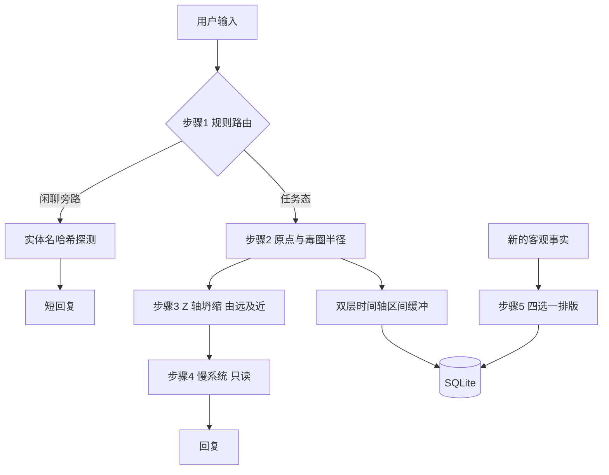

# 认知记忆引擎

一个按固定五步链路实现的记忆系统：规则路由、渐近原点与毒圈半径、平行 Z 轴坍缩、只读慢系统、3D 笔记本写入。确定性部分用代码完成，需要语义判断的三处走同一份可替换的模型客户端。

本仓库的小规模数字是一次离线 mock 运行的实测，不是语言模型的质量分数，也不是下面那张作者目标表。

## 架构



| 步骤 | 做什么 |
| --- | --- |
| 1 | 命中已有 Z 轴实体，或命中改期、回溯、决策等句法，就进入任务态；否则走闲聊旁路。 |
| 2 | 把原点放到当前决策对应的主题块上。事实到原点的距离有下界 `max(0.05, raw_dist)`，到不了 0。距上一次记录不超过 `Δt` 就并进同一个时间节点。 |
| 3 | 每条 Z 轴单独成桶。扫描顺序是联想距离从远到近，圈外的例外和圈内的常规背景一起交给下一步，圈外优先。 |
| 4 | 慢系统只生成回复。它不能改笔记本，也不能改毒圈半径。没有显式实体路径的事实当作噪声丢掉。 |
| 5 | 新事实四选一：同行覆写、紧挨换行、孤立隔行、或忽略。覆写会留下行修订，供「第 N 次修改之前」回溯。 |

代码对照和简化决定写在 [docs/DESIGN.md](docs/DESIGN.md)。

## 安装

```bash
pip install -e ".[dev]"
```

依赖是 Python 3.10+、`numpy`，开发时再加 `pytest`。

## 配置模型

只需要一个 OpenAI 兼容的 chat completions 接口。

| 环境变量 | 含义 | 默认 |
| --- | --- | --- |
| `LLM_BASE_URL` | 接口根路径，客户端会请求 `{base}/chat/completions` | `https://api.openai.com/v1` |
| `LLM_API_KEY` 或 `OPENAI_API_KEY` | 密钥 | 空 |
| `LLM_MODEL` | 模型名 | `Qwen2.5-7B-Instruct` |

没有密钥时，引擎使用确定性 mock，单测和评测都可以离线跑完。mock 读的是 `prompts/` 里填好的三份提示词，再按同一套规则给出 JSON。

```python
from memengine import CognitiveMemoryEngine

engine = CognitiveMemoryEngine(db_path="memory.db")
engine.add("老周对苯甲酸钠过敏，不能食用含该防腐剂的食品。")
print(engine.answer("老周对哪种防腐剂过敏？")["response"])
```

`add(..., sync=False)` 把落库放进队列，`drain()` 再写。`answer` 不会把推理结果写回存储。

## 测试

```bash
python3 -m pytest
```

覆盖路由、时间轴合并、`eps` 下界、Z 轴分桶隔离、四种笔记本操作，以及慢系统不能写库。

## 评测

```bash
python3 -m eval.run_eval --scale small
python3 -m eval.run_eval --scale full --out eval/results/full_eval.json
```

`--scale small` 约为规格规模的 10%–20%：Test 1 约 1.2 万 token 噪声、4 条孤立事实、间隔 10 轮；Test 2 强化 6 轮后改口；Test 3 关键事实间隔 16 轮；Test 4 为 10 条寒暄加 10 条陷阱。种子默认 42。`--mode auto` 在有密钥时走真实接口，否则走 mock。

四组系统：

| 系统 | 内容 |
| --- | --- |
| Baseline A 朴素 RAG | 固定 200 字分块，哈希向量取 Top-5。回复是这 5 块的拼接。 |
| Baseline B 自写 CRUD | 本仓库自己写的实体键 CRUD 加 8 轮原始窗口。同属性覆盖为最新值，并做一层共享键连接。不是 Mem0 或 Letta，也没有使用它们的代码。 |
| Variant C | 完整链路去掉时间轴区间缓冲和闲聊旁路，问句全部走任务态。 |
| Full System | 五步都在。 |

准确率：回复包含全部关键词，且不包含禁用词。陷阱幻觉率：无否定地写出诱饵断言，或在零关联问题上吐出受保护的稀有词。上下文压缩只统计任务态问句，`1 - 上下文 token / 全量历史 token`。时间轴节点减少 = `1 - 节点数 / 记录次数`。P95 只量检索，不含慢系统生成。

### 作者目标（非本仓库实测）

下表来自规格说明，是作者给出的验收目标，不是这次运行的结果。

| 指标 | Naive RAG | Mem0/Letta | 目标 |
| --- | --- | --- | --- |
| 单次孤立事实准确率 | 42.5% | 68.0% | > 91.0% |
| 知识动态更新准确率 | 31.0% | 74.5% | > 94.0% |
| 跨维度多跳推理准确率 | 38.0% | 65.0% | > 85.0% |
| 上下文 Token 压缩率（相对全量历史） | 65.0% | 78.0% | > 92.0% |
| 无关联陷阱幻觉率（越低越好） | 24.0% | 16.5% | < 4.5% |
| 时间轴存储压缩 | — | — | 节点减少 60%–75% |
| P95 检索延迟 | 180 ms | 850 ms | 闲聊 < 15 ms，任务态 < 120 ms |

### 小规模实测

模式：**mock**。环境里没有 LLM API key，Full System 和 Variant C 都走确定性离线规则，基线 A/B 也不调用模型。下表是 `eval/results/small_eval.json` 里的数字。它们描述的是这套规则和检索基线在合成集上的行为，**不能当作记忆质量分数**，也不能拿去和上一张目标表比较高低。

种子 42。规模：噪声约 12000 token，孤立事实 4 条，间隔 10 轮；周会强化 6 轮后改口，再隔 1 轮提问；两则出行场景，关键事实间隔 16 轮；寒暄 10 条，陷阱 10 条。

| 系统 | Test1 孤立事实 | Test2 动态更新 | Test3 多跳/时间 | Test4 路由准确率 | Test4 陷阱幻觉率 | 任务态上下文压缩 | 时间轴节点减少 | P95 闲聊 ms | P95 任务 ms |
| --- | --- | --- | --- | --- | --- | --- | --- | --- | --- |
| Baseline A 朴素 RAG | 100.0% | 0.0% | 0.0% | — | 20.0% | 90.5% | — | — | 0.179 |
| Baseline B 自写 CRUD | 100.0% | 100.0% | 50.0% | — | 0.0% | 83.0% | — | — | 0.010 |
| Variant C | 100.0% | 100.0% | 100.0% | 25.0% | 0.0% | 97.8% | 0.0% | — | 5.528 |
| Full System | 100.0% | 100.0% | 100.0% | 100.0% | 0.0% | 97.8% | 97.0% | 0.145 | 6.203 |

这次运行里能直接看到的结构差异：

- Test 2：朴素 RAG 的 Top-5 同时含有「改到周五」和多次「周三」旧句，禁用词命中，准确率为 0。覆写后的系统只留下周五。
- Test 3：自写 CRUD 能回答当前预算，但覆盖时丢掉旧值，两道「第二次修改之前」都答成了最新数字，准确率 50%。完整系统和 Variant C 用行修订回答了修改前的值。朴素 RAG 的 Top-5 把两个人的多次预算混在一起。
- Test 4：完整系统 20 条路由全部符合规格规则。Variant C 关掉闲聊旁路后，15 条本应走闲聊的输入被送进任务态，路由准确率 25%。朴素 RAG 在两条零关联问题上吐出了库里的稀有事实（含门禁密码），幻觉率 20%。
- 时间轴：完整系统 265 次记录收成 8 个节点（97.0%）。这是伪代码「间隔不超过 `Δt` 就延长 `t_end`」在每轮相隔 1 秒、`Δt = 10` 秒时的结果，会话几乎不空闲，所以远高于作者目标里的 60%–75%，不是那一档目标被完成。Variant C 关闭缓冲，280 次记录对应 280 个节点，减少 0%。
- 延迟是进程内 mock 的检索时间，数量级是毫秒以下到数毫秒。没有模型往返，不能和作者目标里的 15 ms / 120 ms 对照。

原始 JSON 和这份表也在 `eval/results/small_eval.json`、`eval/results/small_eval.md`。

## MemBench

评测数据用官方仓库 [import-myself/Membench](https://github.com/import-myself/Membench) 的 `MemData/`（论文 [arXiv:2506.21605](https://arxiv.org/abs/2506.21605)）。README 徽章写着 MIT，仓库里没有 `LICENSE` 文件。镜像压缩包在 [Google Drive](https://drive.google.com/file/d/112Zraj4pTPH4Idph6i1uMOLA_LPFdGr0/view?usp=sharing)。论文正文用的加噪抽样在 `data2test`，这个目录不在公开 git 树里，所以下面的运行用的是分类后的 `MemData`，不是 Sub-dataset 1/2。

每条轨迹 `add` 进一个新的 `CognitiveMemoryEngine`，再用 `answer` 回答四选一。准确率按论文口径：抽出的选项字母与 `ground_truth` 一致。另外用同一个作答头做两条对照：无记忆（只有问题和选项）、全上下文（整段对话加问题和选项）。有密钥时作答头是 `LLM_*` 指定的模型；没有密钥时作答头是词面重叠选择器，引擎仍走离线 mock。

```bash
python3 -m eval.membench.run --sample 20 --mode mock

export LLM_BASE_URL=https://your-endpoint/v1
export LLM_API_KEY=sk-...          # 或 OPENAI_API_KEY
export LLM_MODEL=Qwen2.5-7B-Instruct
python3 -m eval.membench.run --sample 20 --mode live --model Qwen2.5-7B-Instruct \
  --out eval/results/membench/sample20_live.json
```

`--sample` 是每一大类的条数（参与/观察 × 事实/反思）。缺的官方 JSON 会下载到 `eval/membench/.cache/MemData/`，也可以用 `--data-dir` 指向已经解压的 `MemData`。

### 论文报告值（不是本次实测）

来源：Tan 等，MemBench，arXiv:2506.21605，Table 5，模型 Qwen2.5-7B-Instruct，Sub-dataset 1。

| 方法 | 事实·参与 | 事实·观察 | 反思·参与 | 反思·观察 |
| --- | --- | --- | --- | --- |
| FullMemory | 0.647 | 0.786 | 0.733 | 0.883 |
| RetrievalMemory | 0.692 | 0.883 | 0.692 | 0.883 |
| RecentMemory | 0.639 | 0.800 | 0.700 | 0.867 |

### 本次抽样实测

模式：**mock**。环境里没有 LLM API key。80 条（每类 20，种子 42）。估计 token 443058，接口没有返回费用，`cost_usd` 为空。这些数字不能当作质量分数，也不能和上一张 Sub-dataset 1 的表比高低。

| 系统 | 参与·事实 | 参与·反思 | 观察·事实 | 观察·反思 | 总体准确率 | Recall@10 | 写入 ms/次 | 读取 ms/次 |
| --- | --- | --- | --- | --- | --- | --- | --- | --- |
| 引擎 answer() | 0.0% | 0.0% | 0.0% | 0.0% | 0.0% | — | 0.987 | 0.645 |
| 引擎检索 + 同一作答头 | 15.0% | 35.0% | 25.0% | 20.0% | 23.8% | 0.0% | 0.987 | 0.645 |
| 无记忆基线 | 15.0% | 35.0% | 25.0% | 20.0% | 23.8% | — | — | — |
| 全上下文基线 | 30.0% | 35.0% | 50.0% | 25.0% | 35.0% | — | — | — |

这次 mock 运行里，80 道英文选择题全部被规则路由判成闲聊旁路，检索上下文为空，Recall@10 为 0。因此「引擎检索 + 同一作答头」和无记忆基线逐题相同（空上下文时选择器固定选 A，总体 23.8% 就是标准答案为 A 的比例）。`answer()` 的离线回复里没有 A–D，严格字母准确率是 0。全上下文选择器看得到原对话，总体 35.0%。按写入 token 把同一作答头分成三段，准确率是 15.4% / 26.9% / 28.6%（26、26、28 条）；因为检索是空的，这三段只是「答案恰好为 A」的比例，不是容量曲线上的记忆效果。

原始结果：`eval/results/membench/sample20_mock.json`、`eval/results/membench/sample20_mock.md`。

## 目录

```
memengine/          五步引擎、SQLite、模型客户端、抽取与策略
prompts/            三份规格提示词
eval/               合成评测、MemBench 加载与打分、results/
tests/              pytest
docs/DESIGN.md      步骤对照、简化决定、缺口
docs/SPEC.md        规格原文（与所有者 Google Doc 对应）
.github/workflows/  CI：pytest + 小规模 mock 评测冒烟
```
