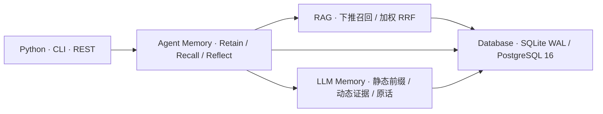
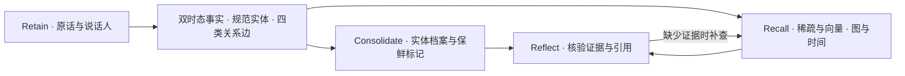

# 记忆引擎设计

这是实现契约。`SPEC.md` 是原始提案；其中的伪代码和目标数字不是当前实现或实测结果。

## 写入与 2D 排版

`CognitiveMemoryEngine.add` 先写入 `raw_turns`，保存包括空白和外部 step 标签的原文，返回自增 `turn_id`。随后按 `(user_id, agent_id, session_id)` 查候选段落。相似度最高的 8 个段落各保留最近 5 行，另保留所有命中实体的活跃行。Live 通过 `notebook_layout.txt` 一次抽取和排版，提供最近同会话上下文供指代消解，并以当前轮次的 UTC 日期解析相对时间。原始消息与角色做 HTML 转义后放入 `untrusted_utterance`。引擎验证操作类型、允许目标、目标属性和删除意图。硬删除只能通过显式接口触发。

| 操作 | 存储与布局 |
| --- | --- |
| `OVERWRITE_SAME_LINE` | 同一块、同一行序生成新事实 ID，继承 `root_fact_id`，以 `supersedes_id` 链接旧版本、增加修订号并对来源 turn ID 和 step ID 分别求并集。旧版本封口为 `superseded`，保留索引。 |
| `APPEND_ADJACENT_LINE` | 在同一主题追加相邻行。 |
| `INSERT_ISOLATED_LINE` | 为一次性约束或例外留空行；渲染时与邻行隔开。 |
| `DELETE_LINE` | 将活跃版本置为 `deleted` 并设置 `valid_until`，整条链从普通检索隐藏。 |
| `NOOP` | 确认重复事实时，仅给命中版本补充来源 turn ID 和 step ID。 |

每个操作自带文本、属性和值。`plain` 来自清洗后的 `formatted`，新事实都绑定原文 `turn_id`。Mock 及解析失败的回退用 `extract_facts` 与 `decide_layout`。类目是可选软标签，`categories=[...]` 扩展标签词表，自由实体和未知标签均可保存。

会话窗口按用户、Agent、会话隔离，默认 6 轮。`buffer_turn` 同步保存原话到 `raw_turns` 的缓冲态。`add(trigger="session_end")` 先记原文，并保留待提取状态。`flush_session` 在 Live 下用一次布局请求处理待提取轮次，每项操作只接受该批次的来源 ID，按来源轮次解析相对时间。Mock 走确定性抽取，并在前一轮只有一个明确主体时消解简单指代。

写前先查热库规范化 SHA-256，再查向量 Top-3。余弦不低于 `0.92` 且通过数值、日期、否定和已识别属性检查时，可以复用活跃版本。自动合并在同会话、同角色内完成，以维持会话查询和原文钻取隔离。成功合并追加原文指针和 `mention_count`，不会产生新版本。明显状态变更进入布局判断。

## 读入、分区与排序

1. **路由。** 纯寒暄且无已知实体、疑问或记忆线索时直接返回 `CASUAL_2D_BYPASS`。任务查询在本地解析意图、扩展语义查询并运行 `parse_temporal_intent`，从候选预览和实体线索计算原点与边界。启用远程向量或精排后，路由仍在本地执行。
2. **召回与精排。** 在一个 SQLite 读取快照中，向量、FTS5 BM25、实体倒排和时间四路分别取 `per_channel_k` 条，默认 `35`。四路权重依次为 `0.40 / 0.35 / 0.15 / 0.25`，以 `k=60` 做加权 RRF，融合 Top-40 进入精排。向量以 NumPy 批量计算余弦，全文以英文代码词元和 CJK 单字、相邻双字索引，实体走归一化精确倒排。时间路在历史意图或 UTC 时间窗口触发，明确窗口内有匹配时降低窗口外候选的 RRF 权重。详情和键集中两条 SQL 加载。默认本地精排结合 RRF、词项覆盖、余弦、时间和带证据锚点的意图匹配。配置远程 `/rerank` 时，提交问题与事实纯文本，按 `index` 回填合法的 `[0,1]` 分数。响应无效或服务失败时回退本地。
3. **巩固频次坐标。** `c_m = max(1, len(source_step_ids), len(source_turn_ids)) + hit_count`，`c_max` 取当前 RRF 池非杂讯最大频次。新闻主题或仅有新闻 Z 键时，`r_m=0.5`；`c_m=1`、孤立、覆写、冲突或历史修订时，`r_m=1`；其余事实用 `clamp(1 - ln(c_m)/ln(c_max), 0, 0.50)`，`c_max<=1` 时取 `0`。`c_m=c_max=8` 时精确落在 `r_m=0`；`c_m=2, c_max=8` 时被截在 `r_m=0.50`。
4. **对称引力与三区。** `W(r) = max(eps/max(eps,r), eps/max(eps,1-r))`，两端默认 `eps=0.05`：`W(0)=W(1)=1`，`W(0.5)=0.10`。`R_in=clamp(R,0.15,0.35)`，`R_out=1-R_in`。`r<=R_in` 为 `INNER_INTUITIVE`，`r>=R_out` 为 `OUTER_ANTI_INTUITIVE`，中间为 `POISON_BELT`。由远及近分 Z 桶，同一事实 ID 只分给最先扫到的桶，无分区配额。
5. **时序支配与终分。** 只在非历史查询中比较召回前 30 条。存在修订链、共享实体且属性相同或相似度至少 0.52、或不同来源且相似度至少 0.68 时，可检查状态竞争。基于相似度的竞争须有真实状态线索。数量查询比较与查询对齐的子句，跳过问题已明确的数字，如型号。新事实基础精排分达到旧事实的 80% 时才调权。按事件时间、会话顺序、来源轮序、入库时间比较，新事实乘 1.12，旧事实乘 0.65。同链旧版本仍使用默认 0.35 状态权重，历史查询以权重 1 读取旧快照。终分为 `(s_ce * (lambda + (1-lambda) * W) * W_status * W_decay * W_temporal + 0.35 * exact_hit_ratio) * W_version`，其中 `lambda=0.55`。精确命中优先，同分按 RRF 顺序。明确历史窗口和方向时按事件时间辅助排序。
6. **门控与预算。** Cross-Encoder 启用 `tau_abs=0.18` 与 `cliff_ratio=0.45`。分数断崖至少保留 `min_keep=2` 个达到置信底线的证据，精确命中可豁免绝对阈值和长尾移除。哈希精排没有绝对阈值空返或断崖，弱信号仍可保留。通用哈希查询用 RRF 预算槽位保住候选，再用精排、双极和时序分调整顺序。至少三条有重复巩固的非杂讯夹层事实且 `c_max>=4` 时启用分区软裁剪。夹层低于最高分的 `belt_prune_ratio=0.35` 时可裁剪，受最小保留数约束。最终使用 `top_k` 和估算 `token_budget`。启用空返时，严格版本查询或只含独立技术标识符的查询可因无精确命中而空返，`gate_stats` 记录原因。

### 相邻轮次与哈希重排

同一用户、Agent 和会话内，当前轮与前一轮的原始 ID 连续、由不同参与者发出且间隔不超过 20 分钟时，短回复（少于 80 字符）或含承接词的回复可索引上一轮的前 40 Token。独立 FTS5 和 SQLite 向量索引保存合并词元，`fact_anchors.turn_id` 保存上一轮指针。事实文本和本身的来源 ID 保持原样。召回通道在短对话查询中补充候选，哈希排序使用当前文本的逆文档频率加权重合度和合并向量。原话装配可读取已选事实的前一轮指针。

常规哈希候选在头部相关性接近且无冲突、约束和分层权重差异时，使用 0.85 的归一化 RRF 权重稳定首项。事实较长时用 0.25 的 RRF 位置先验混合基础精排分，扩大预算内的候选选择，并继续应用双极、状态和时序系数。

### 精确标识符

FTS5 的热层、冷层和原文虚表使用 `unicode61 tokenchars '._-/@#+:'`。查询和写入共享分词器，中英文支持沿用 CJK 单字、相邻双字与英文完整词元。旧虚表在事务内重建，从双时态账本和原文恢复。版本号、错误码、技术标识、项目名和显式引号名称写入 `exact_identifiers`，按作用域单次批量读取，硬删除时由外键级联清理。

精确查询的通道权重为向量 0.30、BM25 0.26、精确倒排 0.44。版本会保留完整 patch、预发行和构建后缀，`3.11` 与 `v3.11` 规范为同一标识。普通查询中其他版本采用 0.30 的错配系数，并从严格版本结果排除。升级、对比和时间回溯允许返回多个版本。Pure RRF 对照从同一召回过程使用通用四路权重。

配置 `EMBEDDING_BASE_URL`（基础路径或完整 `/embeddings` 路径）和 `EMBEDDING_MODEL` 时使用 `OpenAICompatibleEmbedder`，`EMBEDDING_API_KEY` 由服务端要求决定。`fact_vectors` 按版本保存模型名、维度和 L2 归一的 float32 向量。默认使用本地 `HashedTfidfEmbedder`，远程写入编码失败时保存本地向量；查询只对成功编码的同模型同维度向量计算相似度。模型变更后，已存的其他远程模型向量需要重新索引才能进入向量通道。FTS5、实体和时间通道独立可用。

本机神经组合优先加载 `.[onnx]` 的 `OnnxNeuralEmbedder` 和 `OnnxCrossEncoderReranker`。默认模型分别是 FastEmbed 注册的多语 MiniLM 和 Xenova MS MARCO MiniLM。向量使用既有 SQLite float32 BLOB 缓存，Cross-Encoder 对输出 logits 应用 sigmoid。可用 `HF_ENDPOINT` 指定镜像，或用 `LOCAL_EMBED_MODEL_PATH` 和 `LOCAL_RERANK_MODEL_PATH` 指定完整本地目录。加载 ONNX 失败时尝试 `.[neural]` 的 Sentence Transformers。显式模式初始化失败返回错误，`--backend auto` 记录原因后降级至哈希。

## 上下文装配

`build_context` 发起只读检索，从当前 `(user_id, agent_id)` 的 `core_profiles` 核心快照渲染 `system_prefix`，以 UTF-8 字节的 SHA-256 前 12 位生成 `prefix_version`。快照可用 `set_core_snapshot` 显式保存。预算包含完整前缀，无法容纳时抛出 `ValueError`。

没有画像或规则时前缀为零 Token。动态部分为原子事实保留预算，再加入匹配的 Observation 和原话。竞争事实附带 UTC 月份和「最新／较早」标签，历史快照附带事件日。钻取默认只考虑前两条过置信底线或精确命中的事实，批量读取最新原始来源。默认窗口为 0，遇到短句或代词时才读取同会话邻居。已被入选事实覆盖超过 80% 的原话跳过，剩余原话用关键词窗口裁到每条 ≤100 估算 Token，钻取合计 ≤`min(400, floor(budget * 0.25))`，且仅使用动态预算内 75% 以内的余量。原子事实和 Observation 可继续使用其余动态预算。`evidence_turn_ids` 只记录实际注入的原话。`retrieve(include_raw_turns=True)` 保留原来的同会话邻接读取接口。

## 隔离、时钟与持久化

- `add()` 和 `retain()` 同步持久化原文，可分别传入 `timestamp`、`event_time`、`mention_time` 与 `speaker`。`sync=False` 仅将抽取与事实索引加入当前进程队列，非只读任务查询默认先刷对应用户/Agent 的作业。
- `search` 是 `retrieve` 的兼容封装。指定 `session_id` 时限定会话。省略 `top_k` 与 `token_budget` 时兼容十条与 2,048 Token 默认值。打开 `include_raw_turns` 时，`drilldown_turns` 返回前三条事实所指向原文及同一会话的相邻轮，去重并按 `turn_id` 排序。`timestamp` 是本次调用的时钟参考，`reference_time` 可指定日历锚点。`set_time` 固定时钟，`reset_clock` 恢复原时钟。
- `delete(line_id, *, hard=False, user_id='default', agent_id='default', timestamp=None)`。硬删除覆盖整条版本链及其实体、FTS5 和向量索引。独立 `raw_turns` 日志仍可经原文接口读取，数据擦除若涵盖原文、备份或远程留存，需要分别处理。
- `answer(query, ...)` 通过 `build_context()` 获取会话、任务与长期证据。传入的召回结果按当前作用域和事实状态复核。有任务时，缺证的候选断言写入任务工作区。选择题适配由 `eval/` 负责。寒暄返回空 `response`。
- 显式传入 `mutate_stats=True` 可记录选中事实版本的 `hit_count` 和作用域边界。`facts` 的两个时间视角分别是 `event_time_start/end` 与 `ingest_time/valid_until`，后者记录版本入库和失效。`get_fact_chain` 可按修订顺序审计。`render` 显示活跃行。
- 文件型 SQLite 使用 WAL、`synchronous=NORMAL`、`busy_timeout=5000`、外键，写事务使用 `BEGIN IMMEDIATE`。打开旧库时迁移 `ingest`、`lines`、`line_history`、`line_zkeys`，事务内校验并重建索引，使用 `meta.schema_version=2` 记录版本。原始历史 Token 在入库时按用户/Agent 增量累计。
- `timeline` 仅保留写入审计兼容，默认节点合并间隔 10 秒、时长 300 秒、最多 20 个事件。认知表征统一存于 `facts`，由 `memory_type` 区分事实、观察和执行规则。旧观察记录和核心快照会在打开数据库时幂等迁移。`add()` 不触发反思。

## 蒸馏与冷热分层

`remember` 写入事实或执行规则时验证同会话来源。执行规则包含触发、技巧、成功次数和注册的工具记录 ID。`forget` 可按 ID 或查询软删除，按查询硬删除需要唯一的规范化文本匹配。硬删除覆盖事实链及冷热索引，原文日志按独立保留策略处理。

`consolidate()` 是按需执行的同步离线操作，可交给调用方的后台队列。它以新增事实和工具执行序号作为水位，从有原文依据的多轮主题、明确偏好和成功工具结果生成记录，保留事实与原文指针。核心快照优先纳入活跃约束、可复用执行规则和高置信稳定观察，默认上限为 360 估算 Token，内容不变时保留指纹和更新时间。动态装配按规范化文本排除已在静态前缀中的 Observation，其余 Observation 最多使用 48 Token。

`decay_and_archive()` 存下本轮维护时间，用 `2^(-Δ天/半衰期)` 给常规召回调权，半衰期默认 30 天。活跃执行规则、高置信观察、约束和孤立事实保持热层与系数 `1`。旧版本失效超过 30 天，或非保护且零命中的活跃记录闲置超过 90 天，可降为冷记录。热、冷全文索引分开，向量、实体和时间通道按层读取。显式 `include_cold=True` 和时间回溯可按原相关性读取冷记录，读取不改变其存档层级。

## Agentic Search

`as_tools(user_id, agent_id, session_id)` 绑定宿主作用域，提供 Chat Completions 工具数组、`mcp_definitions()` 与本地 `dispatch_tool`。执行器接受参数对象或 JSON 字符串，校验 Schema、未知字段、范围和来源。被动 `answer` 不分派工具调用。

| 工具 | 契约 |
| --- | --- |
| `memory_search` | 按类型、事件时间和冷热层过滤，过滤发生在各通道截断之前。起点包含、终点不包含。接受 Unix 秒或 ISO-8601，缺时区按 UTC。 |
| `memory_drilldown` | 同租户及同会话内按 `turn_id ± window` 批量读取并去重。 |
| `memory_history` | 按记忆 ID 或精确实体键读取版本链，返回 `supersedes_id`、事件时间、入库时间和 `valid_until`。 |
| `memory_remember` | 只写 `fact` 或 `procedural`。需要同作用域原文 ID，或宿主传入已注册的 `tool_call_id`。规则正文可用 `When <trigger>: <technique>`。 |
| `memory_forget` | 按 ID 软删除或显式硬删除事实链。`reason` 随响应返回给宿主。原文日志独立保存。 |

## P0/P1 评测

`eval/metrics.py` 汇总三组独立指标。检索归因将实际注入的前 K 条事实所持 `source_turn_ids` 映射到官方轮次或会话 ID。原话窗口的覆盖单独记录，窗口邻居不提高事实排名。无金标及无答案样本跳过 Recall/MRR；未匹配的金标保留在分母。更新支配率要求检出活跃新版，且新版排在旧版前、旧版已降权或同链归档可证实。

`Abstain = 正确空返 / 负样本数`，`Empty precision = 正确空返 / 全部空返`，`False-empty = 误空返 / 可回答题数`。空返以动态上下文是否为空判定，静态前缀可以保留。`prefix_hit_rate` 只比较同一轨迹里相邻且均非空的前缀指纹，表示可复用机会。单题轨迹无此指标。P50/P95 测同次配对读取至装配，RRF 使用共享召回耗时加截断与拼接时间。两组统计估算 Token，拆分为 prefix、dynamic 和 drilled raw。

MemBench 保留旧的去重 Top-10 step 指标便于对比，统一证据指标另报。官方 JSON 通过已知 SHA-256 标注已验证的快照。Stress + Precision 是自建合成集，包含已知单次禁忌与完全库外的负样本，分桶覆盖无关实体、未知属性与未知事件。

### P0 历史实跑

全部为 mock / hashed，Top-10、2048 估算 Token。LoCoMo 与 LongMemEval-S 本轮未主动蒸馏前缀，压力集显式蒸馏以评估缓存复用。每格依次为 Full System / Pure RRF。官方基准依发布文件的证据标注评分。

| 数据集、样本、种子和来源 | Evidence R@5 | Evidence R@10 | Evidence MRR@10 | 更新支配率 | 平均注入 Token | 可回答误空 |
| --- | ---: | ---: | ---: | ---: | ---: | ---: |
| MemBench，99 题，42–46，[MemData](https://github.com/import-myself/Membench/tree/main/MemData) | 60.56% / 57.64% | 80.08% / 80.08% | 0.6818 / 0.6943 | — | 529.2 / 545.2 | 0/99 / 0/99 |
| LoCoMo，100 题，42，[官方 JSON](https://raw.githubusercontent.com/snap-research/locomo/main/data/locomo10.json) | 29.99% / 26.01% | 30.87% / 30.87% | 0.2720 / 0.2334 | — | 377.4 / 334.1 | 0/80 / 0/80 |
| LongMemEval-S，100 题，42，[官方 cleaned JSON](https://huggingface.co/datasets/xiaowu0162/longmemeval-cleaned/resolve/main/longmemeval_s_cleaned.json) | 58.72% / 60.47% | 67.87% / 67.29% | 0.5091 / 0.4745 | 50.00% / 35.71%（14 道） | 1915.2 / 1878.3 | 0/86 / 0/86 |
| 压力与负样本，40 题，42，`eval/stress_corpus.py` | 100% / 100% | 100% / 100% | 1.0000 / 0.4583 | — | 170.9 / 336.4 | 0/20 / 0/20 |

- 精确标识符合成集，seed 42，30 道有答案题与 10 道缺失版本题。Precision@1 为 100.00% / 66.67%，MRR@10 为 1.0000 / 0.7037，版本串台率为 0/22 / 1/22，缺失版本空返为 10/10 / 0/10。
- 独立的 20 组高频长对话测试采用固定样本顺序。禁忌 Recall@3 和 Recall@5 均为 100% / 100%，MRR@10 为 1.0000 / 0.4583，夹层压缩为 87.40% / 49.60%，平均事实 Token 为 121.3 / 340.2。
- 对照阶段 D，Full System 的 MemBench 平均钻取从 514.3 降到 6.4 Token，LoCoMo 从 304.1 降到 68.0 Token。LoCoMo 总量还受本轮省去自动蒸馏的影响，证据 R@10 也从阶段 D 的 40.75% 降至 30.87%。新旧阶段的全文分词、门控与前缀协议不同。
- 哈希模式的库外负样本仍可能产生弱信号。Full System 在压力集、LoCoMo、LongMemEval-S 的普通负样本空返分别为 0/20、0/20、0/14。

P1 的协议与持久化测试通过。本机的 PyPI wheel 与模型权重下载均超时，显式 `local-neural` 未成功加载，无本机神经实测分数。

### 阶段 D 历史对照

| 数据集 | 模式 | 样本及随机种子 | 来源 | 退出码 |
| --- | --- | --- | --- | ---: |
| MemBench | mock / 离线 | 99 题，seed 42–46 | [发布文件](https://github.com/import-myself/Membench/tree/main/MemData) | 1 |
| Stress + Precision | mock / 离线 | 40 题，20 对，seed 42 | 仓库内 `eval/stress_corpus.py` 合成数据 | 0 |
| LoCoMo | mock / 离线 | 100 题，seed 42 | [发布文件](https://raw.githubusercontent.com/snap-research/locomo/main/data/locomo10.json) | 0 |
| LongMemEval-S | mock / 离线 | 100 题，seed 42 | [发布文件](https://huggingface.co/datasets/xiaowu0162/longmemeval-cleaned/resolve/main/longmemeval_s_cleaned.json) | 0 |

四套均使用同池候选、Top-10 与 2048 Token 预算。MemBench 保留原始写入协议。其余三套在每个对话入库后显式蒸馏一次。

| Bucket | System | R@5 | R@10 | MRR@10 | Update | Abstain | Empty precision | False-empty | Injected (prefix / dynamic / raw) | Prefix reuse (N) | P50 / P95 ms |
| --- | --- | ---: | ---: | ---: | ---: | ---: | ---: | ---: | ---: | ---: | ---: |
| MemBench（99 题，seed 42–46） | Full System | 58.41% | 75.43% | 0.6651 | — | — | 0.00% | 1.01% | 1042.6 (0.0 / 528.4 / 514.3) | — (0) | 2.50 / 5.80 |
| MemBench（99 题，seed 42–46） | Pure RRF | 57.52% | 80.08% | 0.6995 | — | — | — | 0.00% | 545.2 (0.0 / 545.2 / 0.0) | — (0) | 1.32 / 3.70 |
| Stress + Precision（40 题，20 对，seed 42） | Full System | 100.00% | 100.00% | 1.0000 | — | 25.00% | 100.00% | 0.00% | 580.9 (14.0 / 181.5 / 385.4) | 100.00% (20) | 2.66 / 3.56 |
| Stress + Precision（40 题，20 对，seed 42） | Pure RRF | 100.00% | 100.00% | 0.4583 | — | 0.00% | — | 0.00% | 336.4 (0.0 / 336.4 / 0.0) | — (0) | 1.63 / 2.01 |
| LoCoMo（100 题，seed 42） | Full System | 37.02% | 40.75% | 0.3170 | — | 0.00% | — | 0.00% | 1996.2 (997.6 / 694.5 / 304.1) | 100.00% (90) | 14.90 / 16.83 |
| LoCoMo（100 题，seed 42） | Pure RRF | 27.28% | 31.95% | 0.2345 | — | 0.00% | — | 0.00% | 333.7 (0.0 / 333.7 / 0.0) | — (0) | 9.51 / 10.71 |
| LongMemEval-S（100 题，seed 42） | Full System | 56.69% | 57.27% | 0.4946 | 35.71% | 0.00% | — | 0.00% | 2013.5 (997.1 / 941.7 / 74.7) | — (0) | 48.29 / 71.86 |
| LongMemEval-S（100 题，seed 42） | Pure RRF | 59.69% | 69.42% | 0.4784 | 35.71% | 0.00% | — | 0.00% | 1813.5 (0.0 / 1813.5 / 0.0) | — (0) | 26.95 / 39.40 |

- MemBench 对照阶段 A 清单核对了全部 99 个题目 ID 和证据。旧的去重 Top-10 step Recall 为 75.43% / 80.08%。Full System 有 1/99 道可回答题误空，且 Recall 低于同池 RRF。旧验收条件未达标。
- Stress + Precision 的 20 道负样本都不在库内。Full System 拒掉 5 道，Pure RRF 拒掉 0 道。Full System 的应答题夹层压缩率为 87.40%，Pure RRF 为 49.60%。完整注入还包含静态前缀和钻取片段。
- LoCoMo 对抗题和 LongMemEval-S 拒答题的 Full System 空返分别为 0/20 与 0/14。LongMemEval-S 的更新支配率为 35.71% / 35.71%，分母 14 道。
- 用事实主键查证观察来源后，LongMemEval-S 的 Full System P95 从 621.27 ms 降到 71.86 ms。 LoCoMo 从 138.83 ms 降到 16.83 ms。

全部数值来自 mock 离线运行。前缀复用率以指纹为代理。Live 模式未用于此表。

### 上轮收官实测

2026-11-19 在 Python 3.12 上运行 127 项测试，`eval.regression_guard` 退出 0。冻结门禁核对题目、证据及两份官方 JSON 的校验值。百分比按两位小数显示，MRR 按四位小数显示，空返计数和 Token 上限直接比较原值。以下默认评测为 mock / hashed，Top-10，总预算 2048 估算 Token。RRF 指本轮在同一召回过程获得的通用四路 RRF 对照。

| 基准与样本 | 指标 | P0 | 收官 Hashed | 完整 ONNX | Pure RRF |
| --- | --- | ---: | ---: | --- | ---: |
| [MemBench](https://github.com/import-myself/Membench/tree/main/MemData)，99 题，seed 42–46 | R@5 / R@10 / MRR@10 | 60.56% / 80.08% / 0.6818 | 60.56% / 80.08% / 0.6999 | — | 57.64% / 80.08% / 0.6943 |
| [LoCoMo](https://raw.githubusercontent.com/snap-research/locomo/main/data/locomo10.json)，100 题，seed 42 | R@5 / R@10 / MRR@10 | 29.99% / 30.87% / 0.2720 | 36.85% / 41.95% / 0.3428 | — | 26.01% / 30.87% / 0.2334 |
| [LongMemEval-S](https://huggingface.co/datasets/xiaowu0162/longmemeval-cleaned/resolve/main/longmemeval_s_cleaned.json)，100 题，seed 42 | R@5 / R@10 / MRR@10 | 58.72% / 67.87% / 0.5091 | 61.34% / 70.87% / 0.5230 | — | 60.47% / 67.29% / 0.4745 |
| LongMemEval-S | 更新支配 | 7/14 | 8/14 | — | 5/14 |
| 压力与负样本，40 题，seed 42 | R@5 / R@10 / MRR@10 | 100% / 100% / 1.0000 | 100% / 100% / 1.0000 | — | 100% / 100% / 0.4583 |
| 固定 20 组高频长对话 | 禁忌 R@3 / R@5 / MRR@10 | 100% / 100% / 1.0000 | 100% / 100% / 1.0000 | — | 100% / 100% / 0.4583 |

- MemBench、LoCoMo、LongMemEval-S 与压力集的收官 Hashed 平均注入量依次为 529.3、465.1、1946.2、170.9 Token。可回答误空依次为 0/99、0/80、0/86、0/20。高频长对话的夹层压缩率为 87.40%（RRF 49.60%），平均事实用量为 121.3 Token（RRF 340.2）。
- 精确标识符合成集为 seed 42 的 30 道有答案题及 10 道缺失版本题。Precision@1 为 100%（RRF 66.67%），MRR@10 为 1.0000（RRF 0.7037），版本串台 0/22，缺失版本空返 10/10。
- 完整 ONNX 列等待多语向量权重。FastEmbed 0.9.1、ONNX Runtime 1.32.0 已在无 Torch 的隔离环境安装。Xenova Cross-Encoder 权重通过 SHA-256 校验并完成实推理。单独用哈希向量与该精排跑 40 道压力题，负样本空返由 0/20 到 5/20，可回答误空仍为 0/20，证据 Recall@10 为 55.00%。10 对校准题选择的阈值仍为 0.18 和 0.45，留出的 10 对中负样本空返 0/10、可回答误空 0/10。该结果仅验证精排组件，完整 ONNX 的阈值与官方基准成绩仍待验证。

`--consolidate` 额外实验先冻结同一题的事实召回，再读取蒸馏前缀和匹配 Observation。静态前缀单列预算，动态容量仍为 2048。R@5、R@10 和 MRR@10 继续以装配的事实轮次评分。Observation 按来源轮次统计有证据关联和额外覆盖。前缀命中率比较同一轨迹相邻请求的前缀指纹。

| 收官 Hashed | R@5 / R@10 / MRR@10 关→开 | 平均前缀 / 动态 / 原话 Token 关→开 | 前缀复用 | Observation 覆盖额外金标的题数 |
| --- | --- | --- | ---: | ---: |
| MemBench 99 | 60.56% / 80.08% / 0.6999，持平 | 0 / 522.6 / 6.7 → 198.4 / 663.9 / 6.8 | — | 46/99 |
| LoCoMo 100 | 36.85% / 41.95% / 0.3428，持平 | 0 / 386.2 / 78.9 → 997.6 / 576.5 / 78.9 | 90/90 | 61/100 |
| LongMemEval-S 100 | 61.34% / 70.87% / 0.5230，持平 | 0 / 1945.2 / 1.0 → 997.1 / 2023.4 / 0.0 | — | 4/100 |

MemBench 49 道反思题均注入了带金标来源的 Observation，其中 32 道覆盖了入选事实来源之外的金标。MemBench 和 LongMemEval-S 的每条评测轨迹只有一次查询，前缀复用分母为零。LoCoMo 的 90/90 为前缀指纹复用机会。

### 零 API 五维静态矩阵

当前冻结门禁要求至少 127 项测试通过，同时核对官方文件 SHA-256、原样本与证据清单及最近通过的指标。`scripts/run_static_matrix.sh` 只读本地数据，顺序跑冻结回归、官方全量或分层扩样、长程状态与冷归档、120 题符号检索、隔离与性能、L0–L5 消融。分题型 Recall、MRR、会话 Recall、更新支配与信息密度由具名 JSON 字段渲染。[实跑报告](../eval/results/static_benchmark_report.md)

官方全量表以通用四路 RRF 做对照。逐层矩阵的 L0 从哈希向量与 FTS5 起步，各层共用事实库、装配器和金标，分别叠加标识符、相邻轮锚点、双极重排、时序和蒸馏。L5 固定 L4 的事实选择，并为前缀单列预算。仓库默认关闭蒸馏。长程与隔离均使用固定种子合成夹具。

#### 复现冻结门禁

将官方数据缓存位置和上一轮 99 题清单填入环境变量，然后在仓库根目录执行。蒸馏实验在三个正式基准命令上追加 `--consolidate`，另存 JSON。

```bash
results=eval/results/final-sprint
mkdir -p "$results"
(
  python3 -m pytest -v
  code=$?
  printf '\nExit code: %s\n' "$code"
  exit "$code"
) > "$results/01-pytest.log" 2>&1
python3 -m eval.exact_ident_eval --legacy --out "$results/02-exact-ident.json"
python3 -m eval.bipolar_ablation membench --cohort-only --reference "$MEMBENCH_REFERENCE" --data-dir "$MEMDATA" --out "$results/03-membench.json"
python3 -m eval.stress_precision --out "$results/04-stress-precision.json"
python3 -m eval.locomo.run --sample 100 --seed 42 --data-dir "$LOCOMO_JSON" --out "$results/05-locomo.json"
python3 -m eval.longmemeval.run --sample 100 --seed 42 --data-dir "$LONGMEMEVAL_JSON" --out "$results/06-longmemeval.json"
python3 -m eval.bipolar_ablation stress --out "$results/07-bipolar-stress.json"
python3 -m eval.regression_guard --frozen-only --results "$results"
```

### 双数据库与双模回忆



- `storage.base.MemoryStoreProtocol` 描述持久化、事务与索引查询。DSN 工厂延迟导入 PostgreSQL。原 `memengine.store.Store` 保留 SQLite 入口。两套后端共享账本的版本与溯源操作。
- SQLite 保留 WAL 与 FTS5。向量查找用租户、状态和时效条件下推至 SQL。缓存以用户和 Agent 划分，暖查询复用 float32 矩阵。外部 SQLite 连接写入通过数据库版本检测，事务内写读走真实数据库行。
- PostgreSQL 以连接池提供一致读快照。用 `tsvector` GIN、`pg_trgm` 和精确符号表完成字面召回。常用向量维度可走 pgvector HNSW，缺少扩展时用 SQL 数组点积。配置见 [REST 与 CLI 手册](../README.md#retain--recall--reflect-服务)。
- Retain 将知识分为 `world`、`experience`、`opinion`、`observation`、`procedural`。对同一显式观点的新证据采用 `0.75 × 旧置信度 + 0.25 × 新置信度`。临时覆盖使用 `[valid_from, expires_at)`，保持长期事实的版本链和状态。过期条目可以冷归档。历史时间窗按区间相交召回。
- 默认紧凑 Recall 执行一次 RRF 融合与状态感知精排。兼容的紧凑重构模式从首轮前三条结果提取最多三个桥接键，补搜一轮并保护首轮高位证据。日历或预算模式接入下面的两跳关系图。
- 显式蒸馏稳定事实及工具反馈。前缀按租户和 Agent 编译，默认上限 360 Token。装配时标注经验与观点置信度，显式认知域过滤时只装配对应域。System 2 使用只读快照。

[2026-11-20 双数据库实跑报告](../eval/results/dual_backend_report.md) 包含 PostgreSQL 实连、SQLite 同库缓存消融、LoCoMo 多跳配对与冻结门禁。10K 记录的配对 P95 为 114.411 → 77.218 ms，每次均 15 条 SQL。LoCoMo 282 道多跳题的 Recall@10 两组均为 25.05%。

### 真实日历、版本与记忆闭环



- `chrono.parse_session_clock` 把会话日期转成 UTC Unix 秒。`mention_time` 记录获知时刻，`occurrence_start/end` 记录现实事件的闭区间，`time_precision` 标记粒度。无法定位的相对表达保留其不确定性。`resolve_temporal_spans` 在写入时以会话时间为锚，在检索时以 `reference_time` 为锚。区间相交用于加权，区间外相关性随距离衰减。可读日期和词干进入 `normalized_text`，原话由账本指针保留。
- `versioning` 按产品族、整数元组、粒度、预发布及范围边界比较版本。精确命中加 0.45，粗问细存加 0.32，范围满足加 0.30，细问粗存乘 0.65 并标注粒度不足，硬冲突乘 0.12。明确的版本比较保留多个分支。已识别的实体状态用 `canonical_entity_id` 与 `attribute_slot` 串接 `supersedes_id` 和 `revision`。
- 同库 `entities`、`entity_aliases` 与 `memory_links` 支持 SQLite 和 PostgreSQL。相同租户和 Agent 内的实体、七日事件窗、相似记忆与有明确承接的问答或版本修订，分别生成有限的 `entity`、`temporal`、`semantic`、`causal` 边。语义边基于有界候选中的近邻。说话人自述关联规范实体；同名无法消歧时保留独立实体。
- 重构模式用首轮实体、词法和向量种子激活两跳关系图。每跳信号乘以 `0.65 × 边权 × 边类型系数 / sqrt(度数)`，取同一目标最强路径。高位事实的外延实体与词项触发定向补查，融合池最多 60 条。预算装配保留双极渐近环、版本与状态调权、短证据摘要和总 Token 上限。`top_k` 显式传入时仍限制条数。
- 实体 Observation 随新 `world` 或 `experience` 事实标记 `is_stale`。装配和 `reflect(query, …)` 读取原始新事实验证，蒸馏后以新版本刷新档案。Reflect 最多三轮只读召回，可直接核算有日期证据的事件间隔或版本顺序，返回 `answer`、`cited_memory_ids`、`cited_turn_ids`、`temporal_chain` 和 `rounds_used`。

官方全量、图扩散消融、专项和工程结果见 [本轮实跑报告](../eval/results/chronicle_report.md)。

预算检索对同一存储快照内的词法、向量、实体和日历候选做 RRF 融合。直接命名实体提高词法路优先级，显式日历窗口优先使用发生区间索引。重构从有查询词重合的首轮证据中选种子，图边按源点和目标点度数的几何平均数衰减，并从首轮发现的实体或日期发起定向补查。带同一说话人和语义或因果关系的两跳链可获得有界加分，相关的桥节点可免于夹层软裁剪。

确定性交叉打分比较词形还原后的查询覆盖、低频匹配词、同子句共现和日历吻合度。预算装填保留高排名证据，随后优先收录有支持的桥节点，并按需留出有限的原话配额。验证仍以可引用的当前证据为边界，已知同义词、唯一实体别名、等价的 UTC 区间及同维度单位换算可作为直接支持。

本地 ONNX 精排在预算模式下融合神经与确定性分数，保留由其他检索路支持的候选。原文交叉打分使用有界相关片段。SQLite 的图查询由有界前沿驱动，避免先扫描大范围的事实表。`eval.engineering_bench --graph` 在 10,000 条记录运行 60 道重构和日历查询，门禁校验 100 ms P95 与最多 15 条 SQL。

宽检索的候选深度、CE 对数和上下文 Token 预算独立。可用 `load_local_backends(onnx_wide_pairs=20)` 构造有预算的本地组合，将返回的 `vector` 和 `reranker` 传入 `CognitiveMemoryEngine`。用 `answer(query, token_budget=2048)` 走宽检索。ONNX 每对至多 250 个模型 Token，每批至多 10 对。一次召回中的重构轮次共享对数预算，已评分且正文一致的候选复用分数。调用结果的 `gate_stats` 提供 `ce_pair_limit` 和 `ce_pairs_scored`。

[检索失分报告](../eval/results/failure_autopsy.md) 记录冻结评测和显式预算检索的口径、先验诊断以及相应源码位置。

### 短期会话、任务工作区与长期记忆

- 短期会话使用 `raw_turns.extraction_state='buffered'`，根据用户、Agent、会话读取最近原话。显式 Retain 或批处理复用原轮次 ID。待抽取的轮次不会单独生成长期事实。
- 任务由 `(user_id, agent_id, session_id, task_id)` 标识。任务目标、状态和检查点在 `working_tasks`，工具证据、临时事实、开放问题和暂定结论在 `working_items`。任务过期后不再参与读取和修改。已提交任务在有效期内保留晋升记录。
- `verify_task_item()` 需要支持该断言的同一会话用户原话，或有实证的成功工具调用。引用可以是原话 ID、`turn:123`、`fact:l4`、`tool_call:deployment-check` 或 `item:<id>`。`commit_task()` 在同一数据库事务内重验来源、写入事实并登记 `promoted_fact_id`。临时事实和开放问题留在工作区。
- `build_context()` 返回 `ContextBundle`。动态区按长期证据、任务工作区、近期会话顺序编排。任务与会话各有预算上限。静态段只读取长期档案，最多 360 估算 Token。
- 查询式 Reflect 最多进行三次证据查询。作答前检查引用的作用域与状态，通过原词、版本和日期槽位验证支持关系。模型返回的未核验断言可进入当前任务，由宿主补证。蒸馏与归档有独立的 `maintain()` 入口。
